- [5. Herramientas y recursos](#5-herramientas-y-recursos)
  - [5.1. Clientes gráficos (GUI)](#51-clientes-gráficos-gui)
    - [5.1.1. GitKraken](#511-gitkraken)
    - [5.1.2. GitHub Desktop](#512-github-desktop)
    - [5.1.3. Sourcetree](#513-sourcetree)
    - [5.1.4. VS Code + Git](#514-vs-code--git)
    - [5.1.5. JetBrains Rider](#515-jetbrains-rider)
    - [5.1.6. Comparativa de GUIs](#516-comparativa-de-guis)
  - [5.2. Extensiones VS Code para Git](#52-extensiones-vs-code-para-git)
    - [5.2.1. GitLens](#521-gitlens)
    - [5.2.2. Git Graph](#522-git-graph)
    - [5.2.3. Otras extensiones útiles](#523-otras-extensiones-útiles)
  - [5.3. GitHub CLI](#53-github-cli)
    - [5.3.1. Instalación](#531-instalación)
    - [5.3.2. Comandos principales](#532-comandos-principales)
    - [5.3.3. Ejemplo de flujo completo](#533-ejemplo-de-flujo-completo)
  - [5.4. Recursos de aprendizaje](#54-recursos-de-aprendizaje)
    - [5.4.1. Tutoriales interactivos](#541-tutoriales-interactivos)
    - [5.4.2. Documentación oficial](#542-documentación-oficial)
    - [5.4.3. Cheat sheets](#543-cheat-sheets)
    - [5.4.4. Juegos y gamificación](#544-juegos-y-gamificación)
  - [5.5. Configuración avanzada](#55-configuración-avanzada)
  - [5.6. Errores comunes y soluciones](#56-errores-comunes-y-soluciones)
    - [5.6.1. Errores típicos](#561-errores-típicos)
    - [5.6.2. Recuperación de errores](#562-recuperación-de-errores)
    - [5.6.3. Comandos de emergencia](#563-comandos-de-emergencia)
  - [5.7. Personalizar la terminal: Oh My Posh y Nerd Fonts](#57-personalizar-la-terminal-oh-my-posh-y-nerd-fonts)


# 5. Herramientas y recursos

> 💡 **Punto de partida:** ¿Te imaginas construir un edificio sin herramientas? Podrías, pero tardarías una eternidad. Las herramientas de Git son como tener una grúa, un soldador y un robot: cada una hace un trabajo específico mucho más rápido.

> 💡 **¿Por qué me importa?**
> Dominar las herramientas correctas multiplica tu productividad. Un cliente gráfico te ayuda a visualizar el historial, una extensión de VS Code te ahorra comandos, y GitHub CLI te permite automatizar tareas repetitivas.
> 
> 🔗 **Conexión con otros puntos:** El Punto 04 viste Pull Requests, Forks y colaboración. Este punto verás las herramientas que facilitan todo ese trabajo: clientes gráficos, extensiones, CLI y recursos de aprendizaje.

En el Punto 04 vimos Pull Requests, Forks, Code Review y GitHub Actions. Ahora veremos las herramientas y recursos para Git: clientes gráficos, extensiones de VS Code, terminal Git y trucos para potenciar tu productividad.

**Objetivos de aprendizaje:**

- Conocer los clientes gráficos y los IDE con Git integrado (GitKraken, GitHub Desktop, Sourcetree, VS Code, Rider)
- Instalar y usar extensiones de VS Code para Git
- Dominar GitHub CLI para automatizar tareas
- Resolver errores comunes de forma rápida

## Qué instalar primero

> 📝 **Recomendación del profesor:** Antes de explorar todas las herramientas, instala estas tres. Con ellas tendrás todo lo necesario para el curso.

| Herramienta | Para qué la necesitas | Cómo instalarla |
|-------------|----------------------|-----------------|
| **VS Code** | Editor principal con Git integrado | [code.visualstudio.com](https://code.visualstudio.com) |
| **Git** | Control de versiones en línea de comandos | [git-scm.com](https://git-scm.com) |
| **GitHub CLI (`gh`)** | Gestionar repos, PRs e issues desde terminal | `scoop install gh` (Windows) o `brew install gh` (Mac) |

**Extensiones imprescindibles en VS Code:**

| Extensión | Qué hace |
|-----------|----------|
| **GitLens** | Ver quién cambió cada línea, historial detallado |
| **Git Graph** | Visualizar ramas y commits como un grafo |
| **GitHub Pull Requests** | Gestionar PRs directamente desde VS Code |

> 💡 **Consejo:** Con VS Code + GitLens + GitHub CLI tienes las herramientas profesionales más usadas en la industria. No necesitas más para empezar.

## 5.1. Clientes gráficos (GUI)

Los clientes gráficos facilitan el uso de Git para quienes prefieren interfaces visuales.

### 5.1.1. GitKraken

| Característica | Descripción |
|----------------|-------------|
| **Plataforma** | Windows, Mac, Linux |
| **Licencia** | Freemium (gratis para uso personal) |
| **Puntos fuertes** | Mejor GUI, integra GitFlow, aprendizaje visual |
| **Integración** | GitHub, GitLab, Bitbucket, Enterprise |

> 💡 **Ideal para:** Principiantes que quieren entender visualmente cómo funciona Git.

**Las tres zonas de la ventana**

GitKraken organiza su interfaz en tres zonas principales. Identificarlas es el primer paso para moverte con soltura: todo lo demás está conectado a ellas.

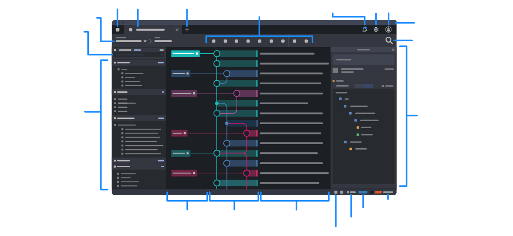

| Zona | Qué contiene |
|------|-------------|
| **Left Panel** (izquierda) | Ramas locales y remotas, pull requests, issues, tags y stashes |
| **Commit Graph** (centro) | El historial visual: cada commit es una fila y las columnas son ramas |
| **Commit Panel** (derecha) | Archivos cambiados, staging y mensaje de commit |
| **Toolbar** (arriba) | Undo, Redo, Pull, Push, Branch, Stash y Pop |
| **Status Bar** (abajo) | Resumen, plan y selector de zoom (de 80 % a 300 %) |

El **Left Panel** se puede ocultar, redimensionar o plegar por secciones, y tiene un cuadro de filtro (`Ctrl/Cmd + Alt + F`) para encontrar una rama escribiendo solo una parte de su nombre:

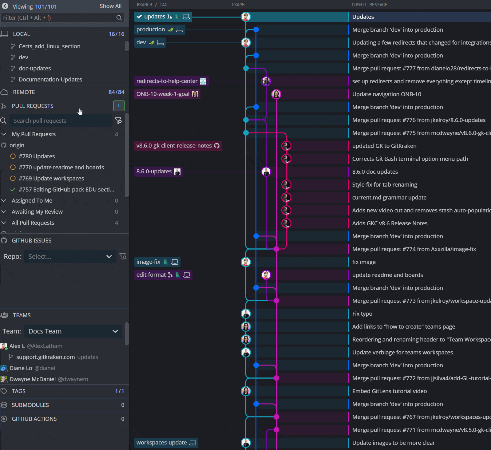

**El Commit Panel: de los cambios al commit**

Esta es la zona donde trabajas a diario. Tiene tres secciones, en el orden en que las usas: primero los archivos **sin preparar** (*Unstaged*), después los **preparados** (*Staged*) y por último el **mensaje de commit**, que se divide en resumen y descripción:

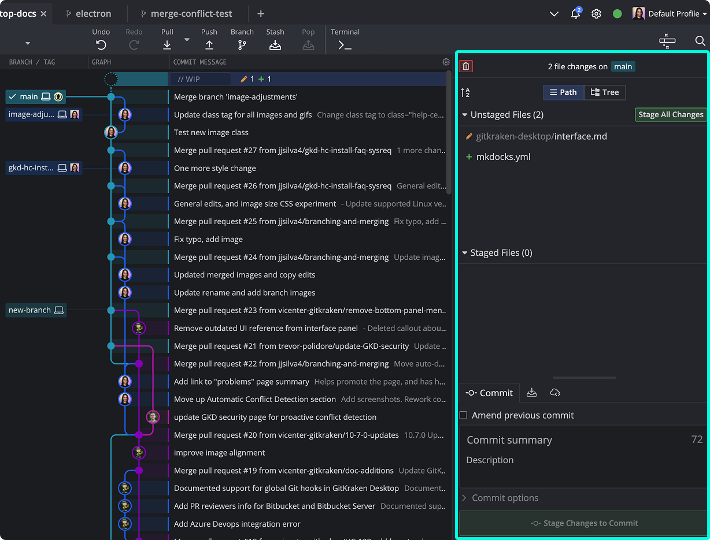

Los archivos llevan un color según lo que les haya pasado; aprendértelos ahorra tiempo:

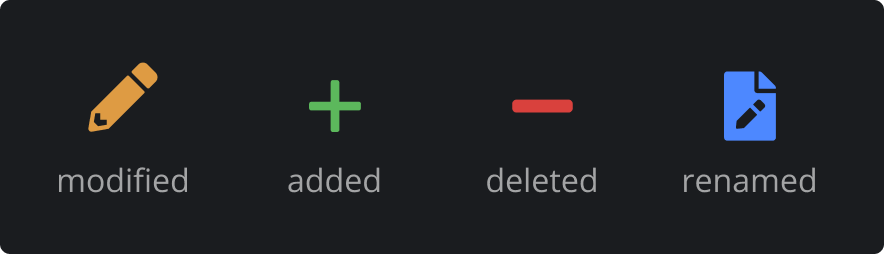

**El Commit Graph y sus columnas**

Cada fila del grafo es un commit, el más reciente arriba, y las líneas muestran las fusiones. La leyenda te dice qué es cada elemento:

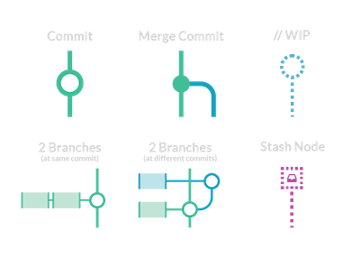

Puedes reordenar las columnas arrastrando sus cabeceras:

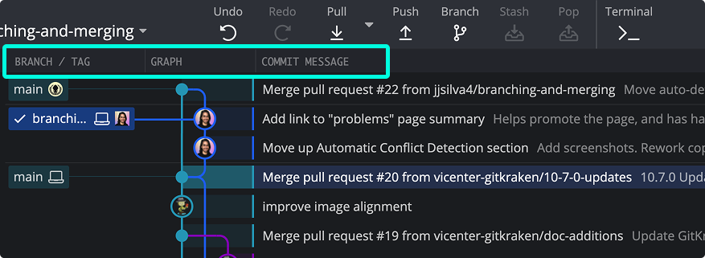

Y activar o desactivar columnas adicionales como autor, fecha o SHA desde el menú contextual o el icono de engranaje:

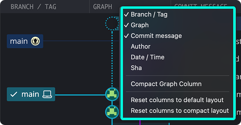

Si trabajas con varios repositorios a la vez, cada uno vive en su pestaña y las de un mismo repositorio con sus *worktrees* se agrupan juntas:

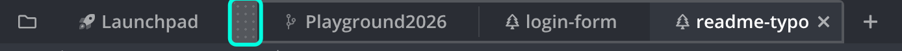

**Tu primer flujo completo en GitKraken**

Con la interfaz clara, el circuito básico de Git se recorre en siete pasos:

1. **Clonar**: `File > Clone Repo`, pega la URL y pulsa *Clone the repo!*.
2. **Crear rama**: clic derecho sobre cualquier commit del grafo y *Create branch here*.

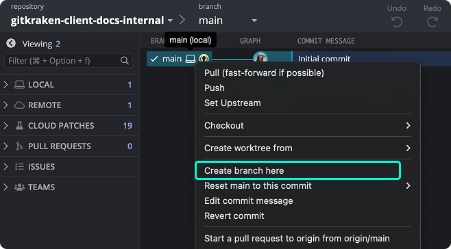

3. **Modificar un archivo**: puedes abrirlo directamente desde el Commit Panel.

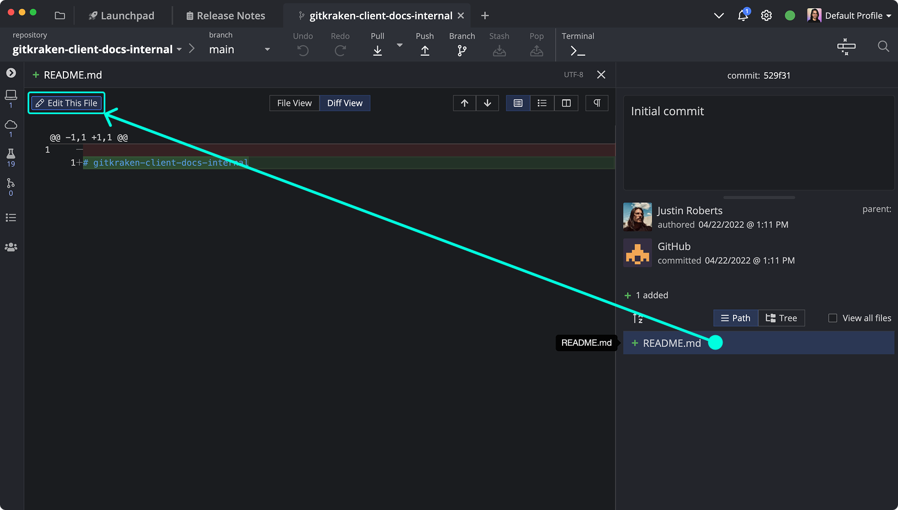

4. **Preparar los cambios**: pulsa el nodo `//WIP` para ver lo pendiente y el botón verde *Stage All Changes*.

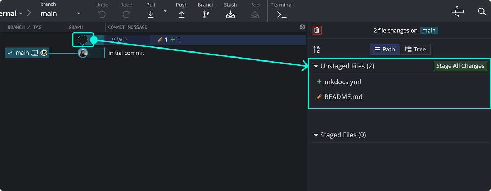

5. **Commit**: escribe el mensaje y pulsa `Ctrl/Cmd + Intro`.

6. **Push**: botón *Push* de la barra de herramientas.

7. **Merge**: cuando la rama esté lista, arrastra tu rama sobre la de destino y elige la fusión.

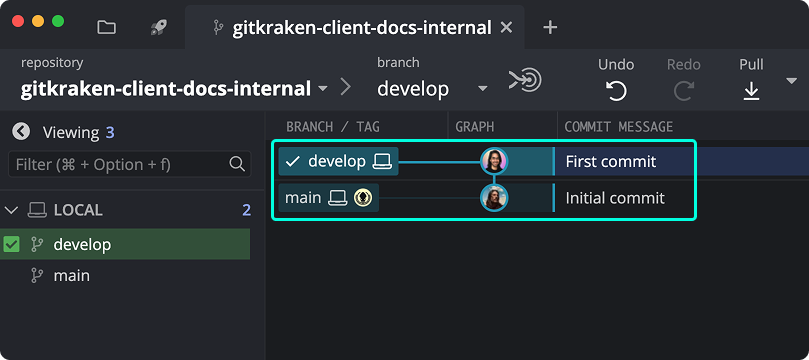

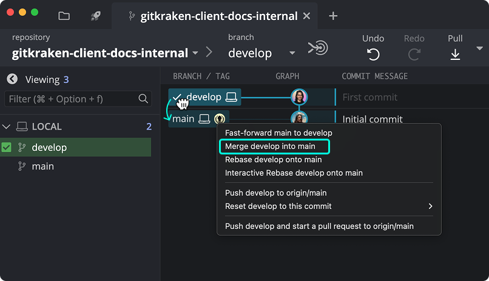

> 📝 **Nota:** Si la fusión tiene conflictos, GitKraken abre su propia **Merge Tool**, donde eliges las líneas de cada lado y confirmas la resolución.

> 💡 **Truco:** Casi todas las acciones del menú contextual del grafo están también en la **paleta de comandos** (`Ctrl/Cmd + P`): si no encuentras un botón, búscalo ahí por nombre.

### 5.1.2. GitHub Desktop

| Característica | Descripción |
|----------------|-------------|
| **Plataforma** | Windows, Mac |
| **Licencia** | Gratis |
| **Puntos fuertes** | Integración nativa GitHub, simple |
| **Limitaciones** | Solo GitHub, menos features |

**Configurar tu cuenta**

Tras instalarlo, añades tu cuenta de GitHub desde *File > Options* (en Windows) o *GitHub Desktop > Settings* (en Mac), en la pestaña *Accounts*:

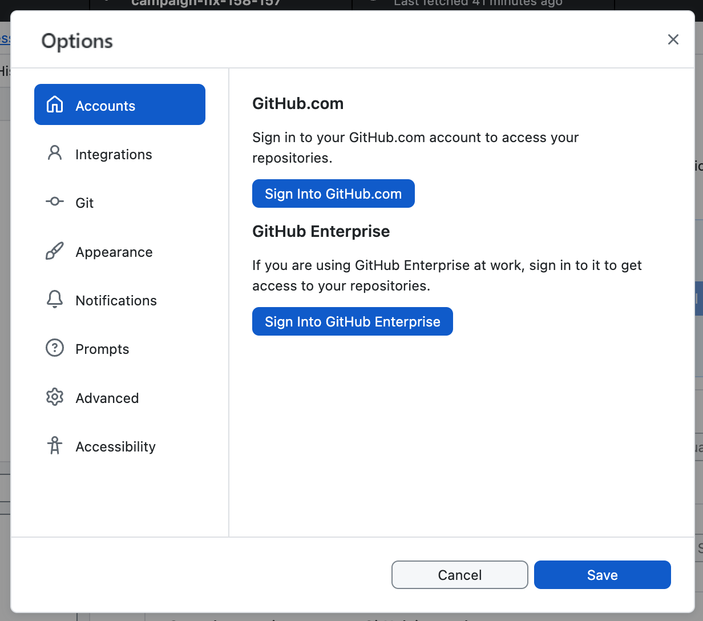

**El menú File: todo empieza ahí**

De este menú salen las tres formas de empezar: crear un repositorio nuevo, añadir uno que ya tienes en local o clonar uno desde GitHub:

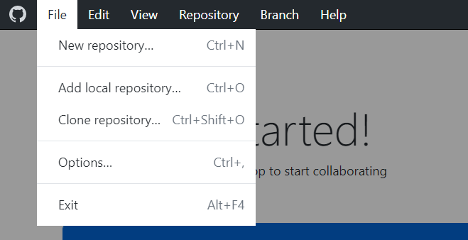

**Elegir rama y revisar los cambios**

La barra de herramientas muestra la rama actual y desde su desplegable cambias o creas ramas:

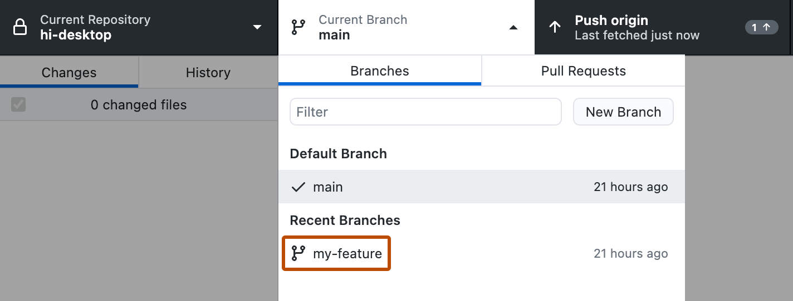

Los cambios aparecen en la pestaña *Changes*, donde marcas qué archivos entran en el commit:

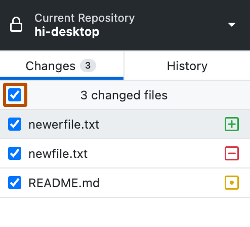

El panel de diferencias admite vista unificada o dividida, y puedes ocultar los cambios de espacios en blanco para concentrarte en lo importante:

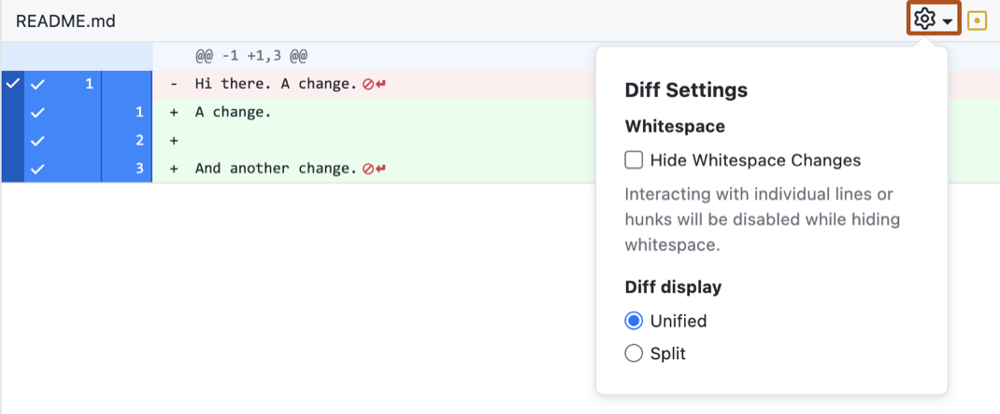

**Commit y push**

Escribes el resumen (y la descripción si quieres) y pulsas *Commit to* la rama actual:

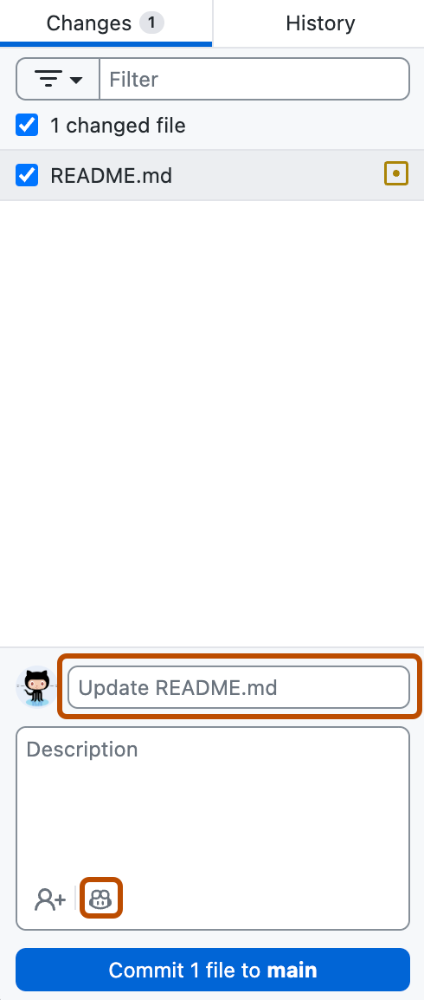

Después, el botón **Push origin** de la barra del repositorio sube todo a GitHub:

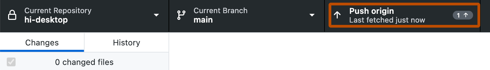

**Crear la pull request**

Si la rama todavía no tiene PR, Desktop te ofrece crearlo sin salir de la aplicación:

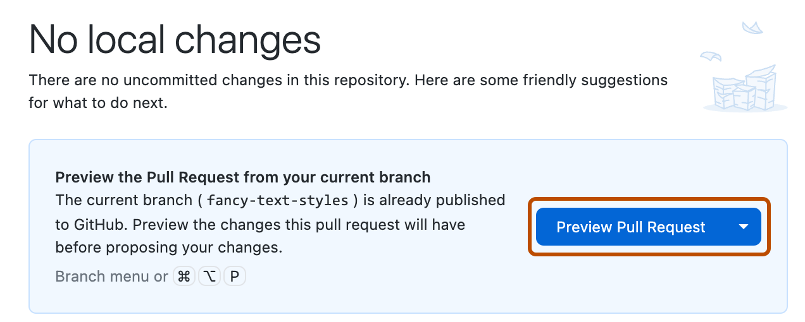

> 💡 **Ideal para:** Quien empieza y vive en GitHub. El circuito completo (rama → commit → push → PR) se hace en tres clics, sin recordar un solo comando.

### 5.1.3. Sourcetree

| Característica | Descripción |
|----------------|-------------|
| **Plataforma** | Windows, Mac |
| **Licencia** | Gratis |
| **Puntos fuertes** | Completo, gratuito |
| **Puntos débiles** | Interfaz anticuada |

**La ventana principal**

Sourcetree es el cliente gráfico **de Atlassian**, la misma casa de Bitbucket y Jira. Su ventana combina el grafo de commits con el panel de cambios:


**El grafo de ramas**

Su fuerte: los diagramas de ramas detallados, que te permiten seguir el progreso de todo el equipo de un vistazo:

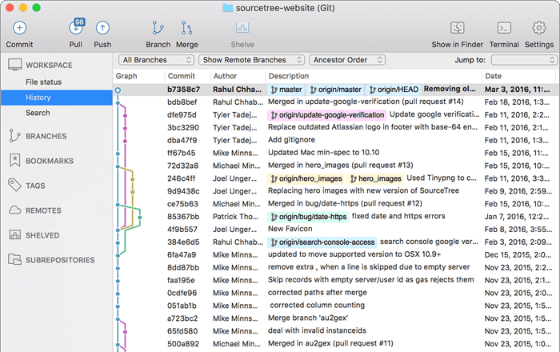


**Revisar cambios y hacer commit**

Diferencias lado a lado, cambios por archivo y un commit con vista previa de lo que vas a subir:

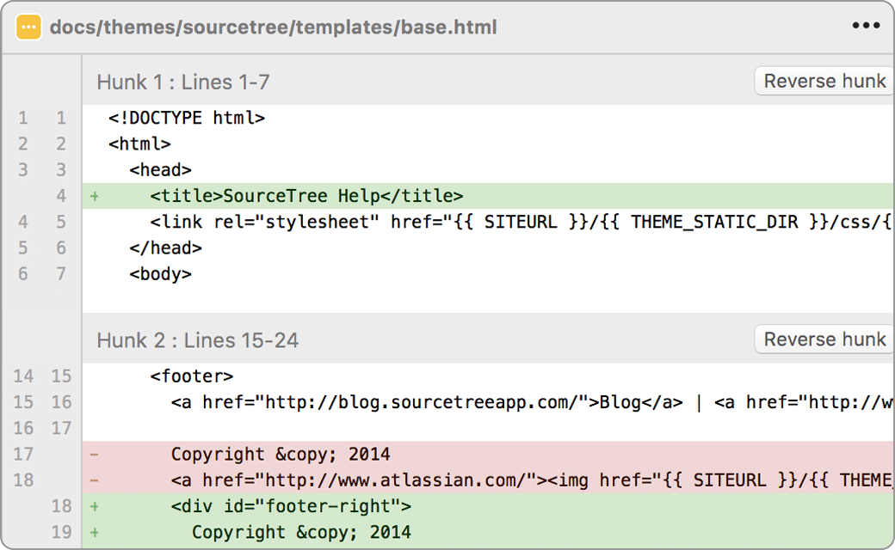

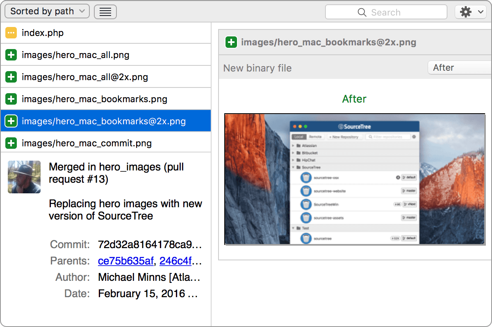

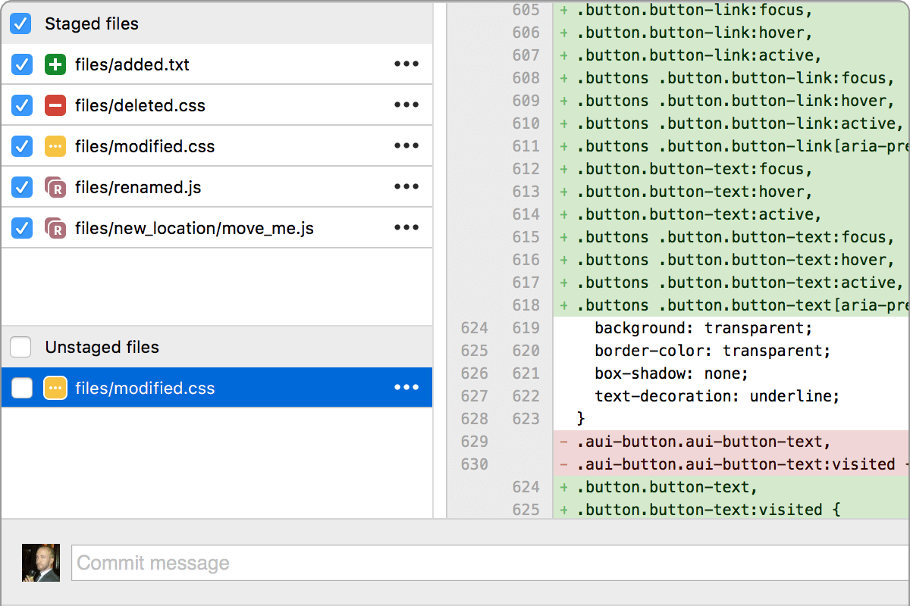

También tienes la vista de estado de Git de un solo vistazo:


**Sourcetree y Bitbucket**

Como ambos son productos de Atlassian, la integración es directa: desde Sourcetree ves tus pull requests de Bitbucket sin cambiar de aplicación. Bitbucket es la alternativa de Atlassian a GitHub, con flujo de trabajo similar (rama, pull request, revisión, fusión):

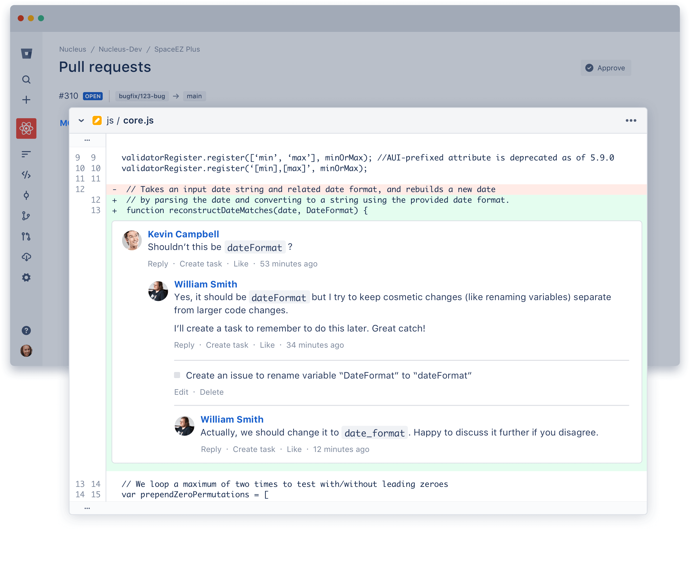

> 💡 **Consejo:** Si en tu centro trabajáis con Bitbucket (o Jira), Sourcetree es la pareja natural. Para GitHub puro, encaja mejor GitHub Desktop o GitKraken.

### 5.1.4. VS Code + Git

| Característica | Descripción |
|----------------|-------------|
| **Plataforma** | Multiplataforma |
| **Licencia** | Gratis |
| **Puntos fuertes** | Ligero, integración nativa, extensible |

**Características Git integradas en VS Code:**

| Característica | Cómo acceder |
|----------------|--------------|
| **Source Control panel** | Ctrl+Shift+G → Vista lateral con cambios |
| **Commit visual** | Escribes el mensaje y clic en ✓ (checkmark) |
| **Diff inline** | Modificaciones resaltadas línea por línea |
| **Merge conflicts UI** | Botones "Accept Current", "Accept Incoming", "Accept Both" |
| **Branch management** | Selector en la barra inferior izquierda |
| **Stash operations** | Click derecho en los cambios → Stash |
| **Timeline view** | Historial de cambios por archivo |
| **Blame annotations** | Click derecho → "Open Timeline" o extensión GitLens |

**El panel Source Control**

Con `Ctrl+Shift+G` se abre el panel lateral con todos tus cambios. Al seleccionar un archivo se abre a su lado el editor de diferencias, donde puedes preparar hasta líneas sueltas:

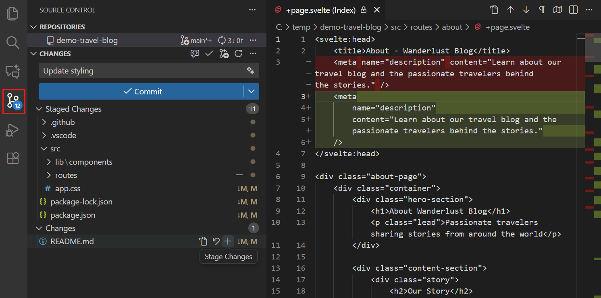

**Empezar un repositorio desde cero**

Si abres una carpeta que aún no es un repositorio, el propio panel te ofrece el botón para crearlo; también puedes lanzar `Git: Initialize Repository` desde la paleta de comandos (`Ctrl+Shift+P`):

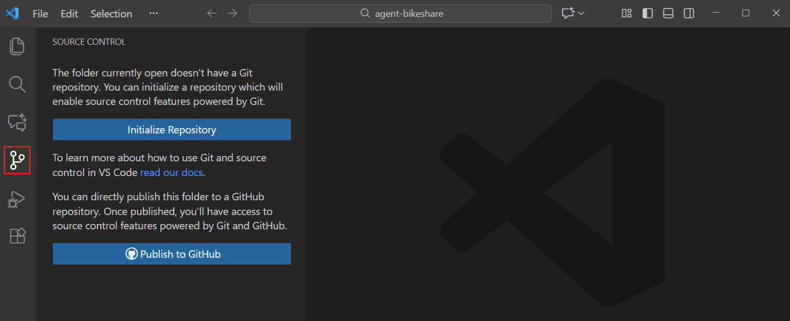

**Resolver conflictos sin salir del editor**

Cuando Git no puede combinar los cambios, VS Code marca los conflictos con sus marcadores (`<<<<<<<`, `=======`, `>>>>>>>`) y ofrece acciones sobre cada uno: *Accept Current Change*, *Accept Incoming Change* y *Accept Both Changes*.

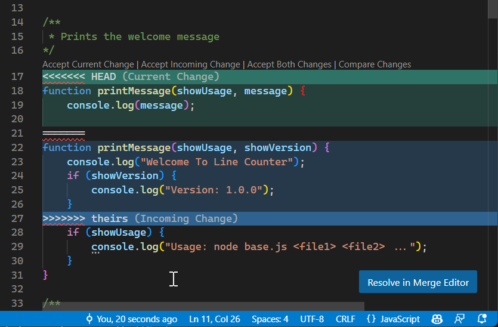

Para conflictos más enredados está el **editor de fusión de tres vías**: entrante a la izquierda, actual a la derecha y el resultado abajo, donde escribes la versión final antes de pulsar *Complete Merge*:

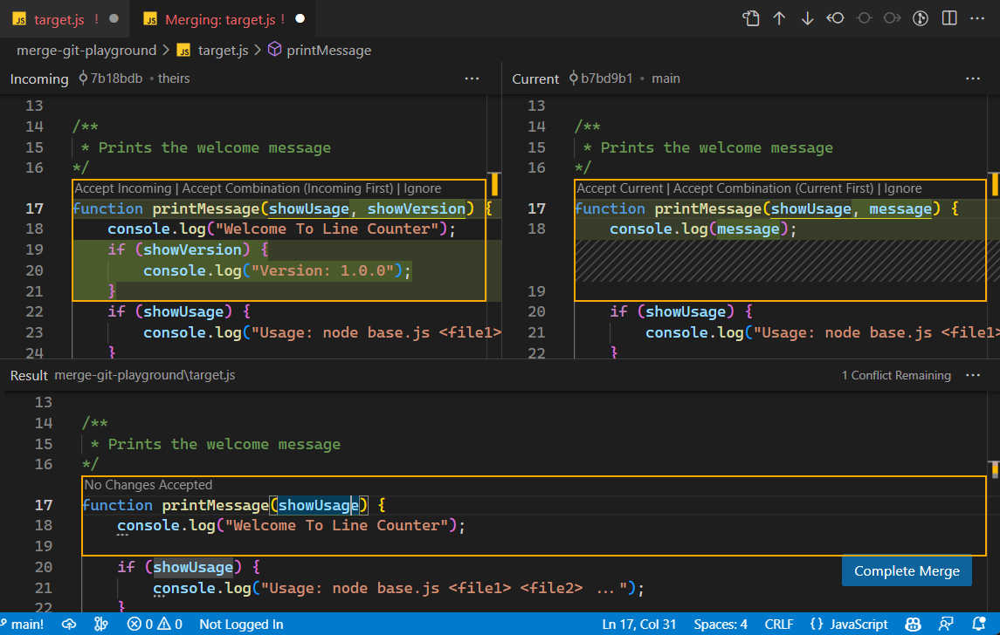

> ⚠️ **Advertencia:** Aceptar ambos lados no garantiza que el código funcione; suele dejar duplicados. Revisa siempre el resultado antes de confirmar.

**Comandos desde la terminal integrada (Ctrl+`):**

```bash
# Todo se puede hacer desde la terminal de VS Code
git status
git add .
git commit -m "feat: añadir login"
git push origin main
git pull --rebase
git stash push -m "WIP: refactorizando"
```

> 💡 **Ventaja:** VS Code combina la comodidad de una GUI con el poder de la terminal. Puedes usar el panel visual para commits rápidos y la terminal para operaciones complejas.

📌 **Ejemplo real:** Spotify, Netflix y miles de empresas usan VS Code como editor estándar. Su integración nativa con Git permite hacer commits, ver diffs y resolver conflictos sin salir del editor. Muchos desarrolladores profesionales ni siquiera abren otra herramienta para gestionar Git.

> 🔗 **Conexión:** Las extensiones GitLens y Git Graph (que verás en la sección 5.2) amplían enormemente las capacidades Git de VS Code.

### 5.1.5. JetBrains Rider

| Característica | Descripción |
|----------------|-------------|
| **Plataforma** | Windows, Mac, Linux |
| **Licencia** | Gratis para estudiantes y docentes; suscripción para empresas |
| **Puntos fuertes** | IDE completo de JetBrains con Git integrado de serie |
| **Integración** | GitHub, GitLab, Bitbucket |

> 💡 **Nota:** Es el IDE principal del curso. No necesitas instalar nada aparte: desde crear el repositorio hasta resolver conflictos, todo ocurre dentro de la misma ventana.

**Crear un proyecto con Git desde cero**

En el asistente de nuevo proyecto basta con marcar la casilla **Create Git repository** para que Rider cree el repositorio junto con la solución:

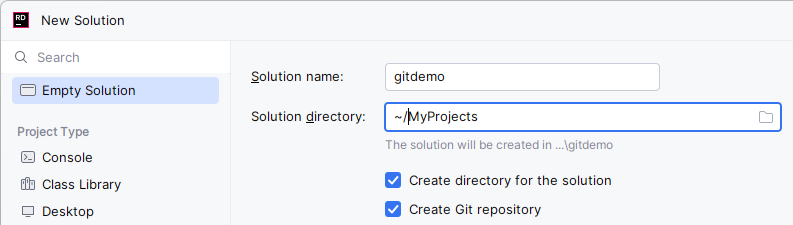

Al crearlo, Rider detecta Git automáticamente y te avisa de los tres accesos que usarás a diario:

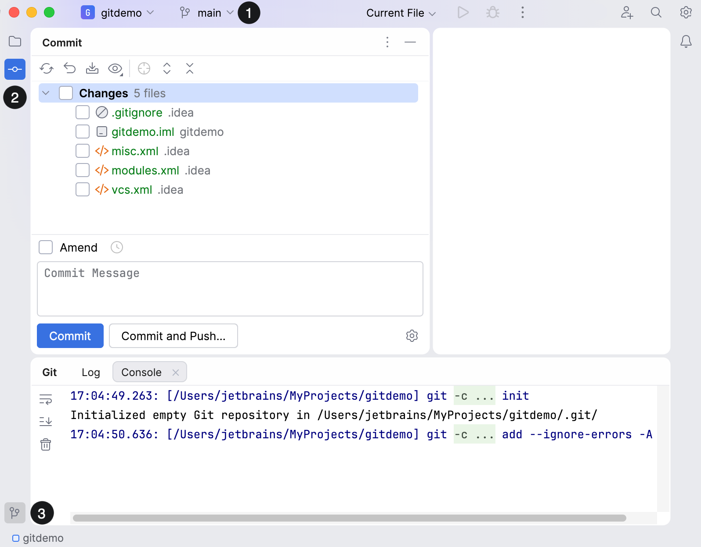

| Acceso | Atajo | Para qué |
|--------|-------|----------|
| **Widget VCS** | barra superior | Ver la rama actual y operar con ella |
| **Ventana Commit** | `Ctrl+K` | Revisar cambios y confirmarlos |
| **Ventana Git** | `Alt+9` | Ver el log, el historial y las ramas |

**Añadir archivos y hacer commit**

Cuando creas un archivo, Rider te pregunta si quieres añadirlo al seguimiento; desde entonces, indexa solo los cambios que hagas:

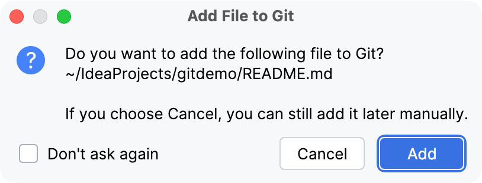

Los archivos modificados aparecen en azul y los nuevos en verde, tanto en el explorador como en las pestañas del editor:

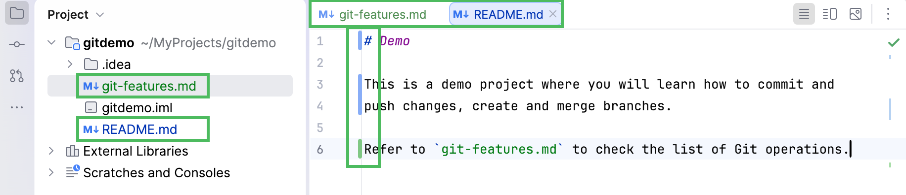

Los tienes todos en la ventana **Commit**, donde marcas los que van en el commit y escribes el mensaje:

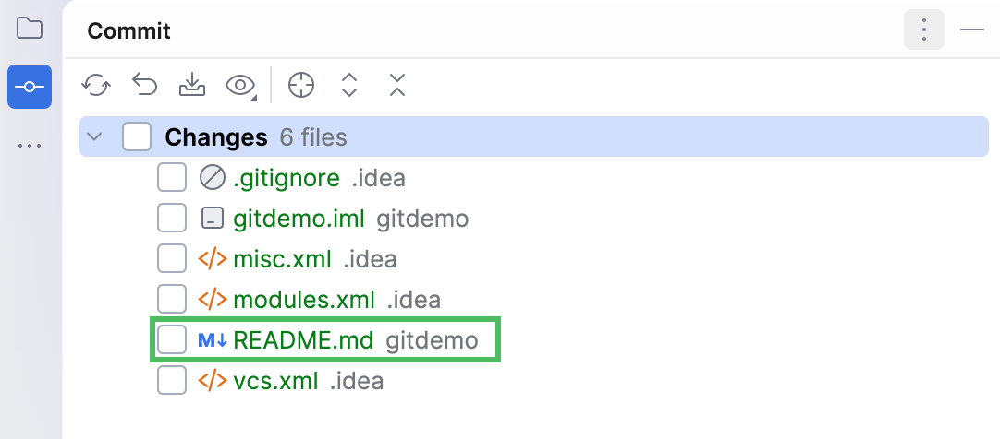

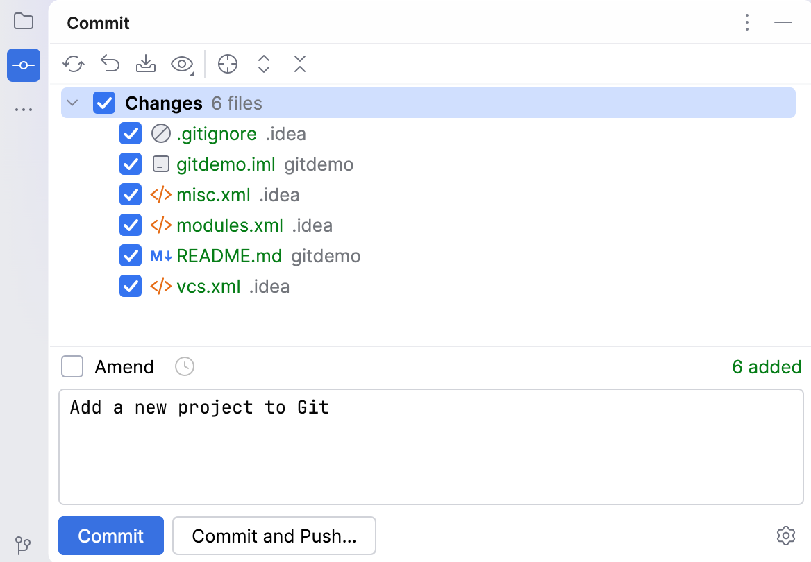

**Ramas y push**

Para crear una rama, pulsa el nombre de la rama actual en el widget VCS y elige **New Branch**:

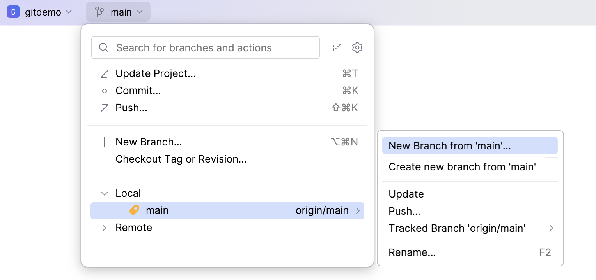

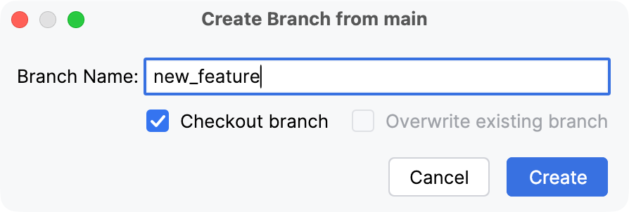

Cuando quieras subir los commits, `Ctrl+Shift+K` abre el diálogo de push, donde revisas exactamente qué se va a enviar:

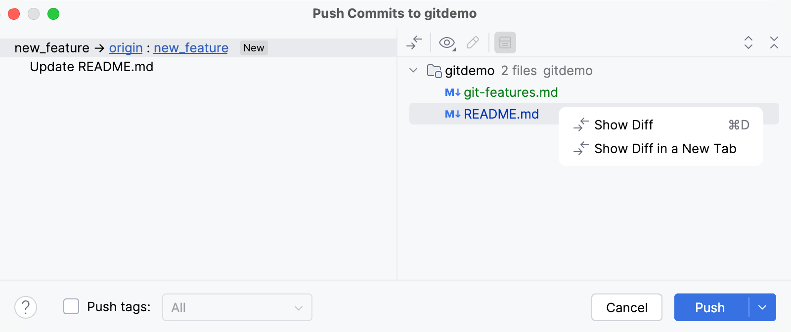

**Fusionar y resolver conflictos**

Desde el widget VCS eliges fusionar una rama en la actual:

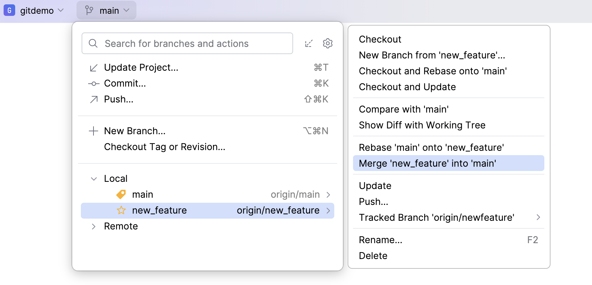

Si hay conflicto, Rider te pregunta qué hacer: conservar lo tuyo, lo de la otra rama o resolverlo a mano:

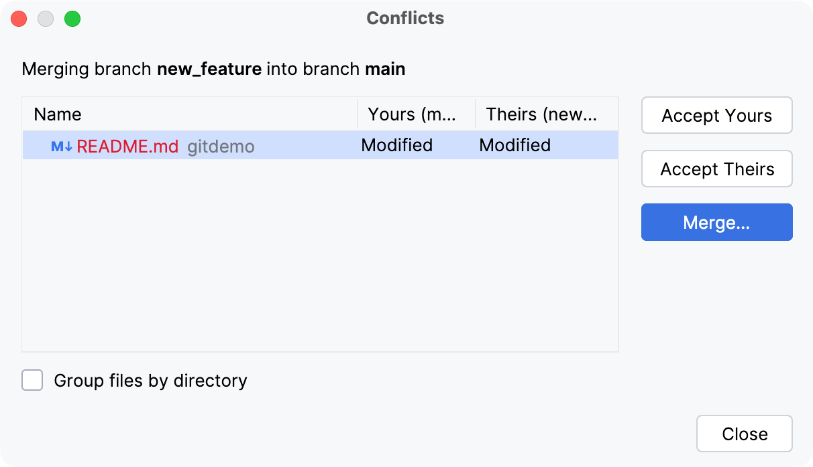

Al elegir **Merge** se abre su editor de tres paneles: los cambios de cada rama a los lados y, en el centro, el resultado que tú vas editando:

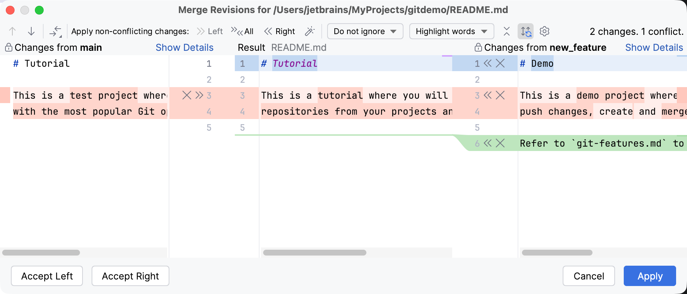

**Consultar el historial**

La ventana Git (`Alt+9`) muestra el log de todas las ramas, desde donde puedes revertir commits o hacer cherry-pick:

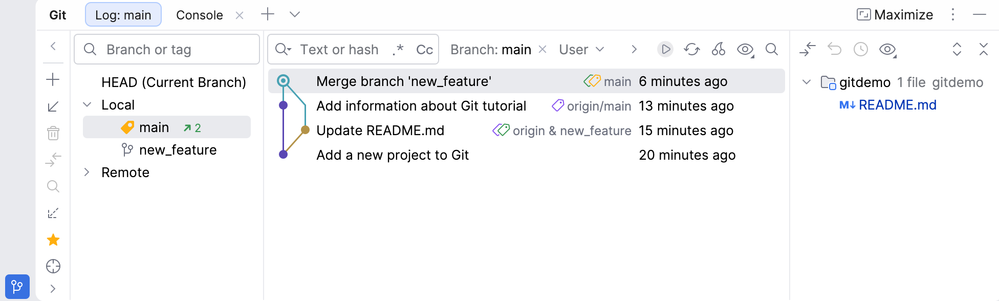

Y con clic derecho sobre cualquier archivo puedes ver qué commits lo han tocado:

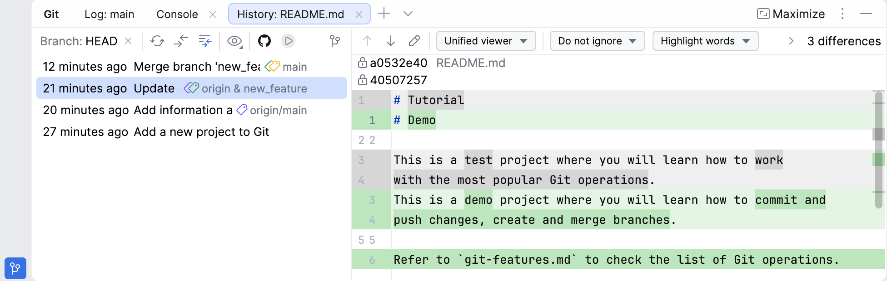

> 📌 **Ejemplo real:** Rider es el IDE que usarás en el ciclo, y su integración con Git es idéntica a la de IntelliJ IDEA: lo que aprendas aquí te vale igualmente para Java o Python en otros módulos.

### 5.1.6. Comparativa de GUIs

| Herramienta | Facilidad | Features | Integración | Precio |
|-------------|-----------|----------|-------------|--------|
| GitKraken | ⭐⭐⭐⭐⭐ | ⭐⭐⭐⭐⭐ | ⭐⭐⭐⭐⭐ | Freemium |
| GitHub Desktop | ⭐⭐⭐⭐⭐ | ⭐⭐⭐ | ⭐⭐⭐⭐⭐ | Gratis |
| Sourcetree | ⭐⭐⭐ | ⭐⭐⭐⭐ | ⭐⭐⭐ | Gratis |
| VS Code + Git | ⭐⭐⭐⭐ | ⭐⭐⭐⭐ | ⭐⭐⭐⭐ | Gratis |
| JetBrains Rider | ⭐⭐⭐⭐ | ⭐⭐⭐⭐⭐ | ⭐⭐⭐⭐⭐ | Gratis (educativo) |

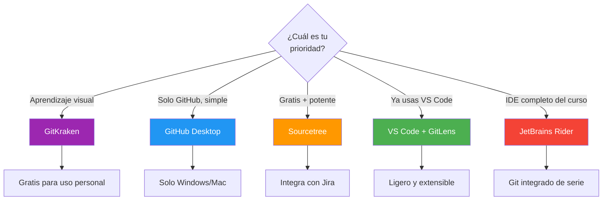

## 5.2. Extensiones VS Code para Git

### 5.2.1. GitLens

| Característica | Descripción |
|----------------|-------------|
| **Función** | Ver blame, historial, comparar commits |
| **Atajo** | `Alt+Shift+A` para blame rápido |

**Features principales:**
- Blame en línea
- Historial de archivos
- Comparar commits
- Buscar en historial
- Visualizar ramas

**El Commit Graph**

Su pieza central: un grafo interactivo con el historial, los cambios sin confirmar y todo lo que está en vuelo en una sola vista, desde donde puedes crear ramas, fusionar, rebasear o hacer cherry-pick sin salir de VS Code:

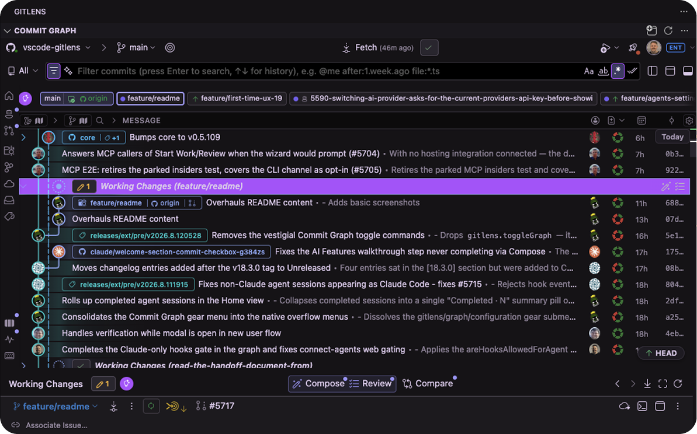

**Historial visual**

Una línea temporal de cómo ha evolucionado un archivo o el repositorio entero: cuándo llegaron los cambios, de qué tamaño fueron y quién los hizo:

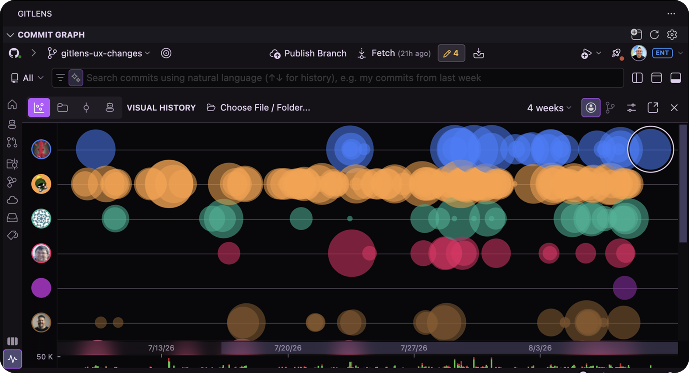

> 📝 **Nota:** La parte básica (blame, hovers, CodeLens e historial) es **gratuita para siempre**. El Commit Graph es gratis en repositorios públicos; para repos privados necesita cuenta GitKraken o licencia Pro.

### 5.2.2. Git Graph

| Característica | Descripción |
|----------------|-------------|
| **Función** | Visualizar historial como grafo |

Así se ve en funcionamiento: cada rama es una línea, cada punto un commit, y con clic derecho sobre cualquiera de ellos lanzas las operaciones de Git directamente:

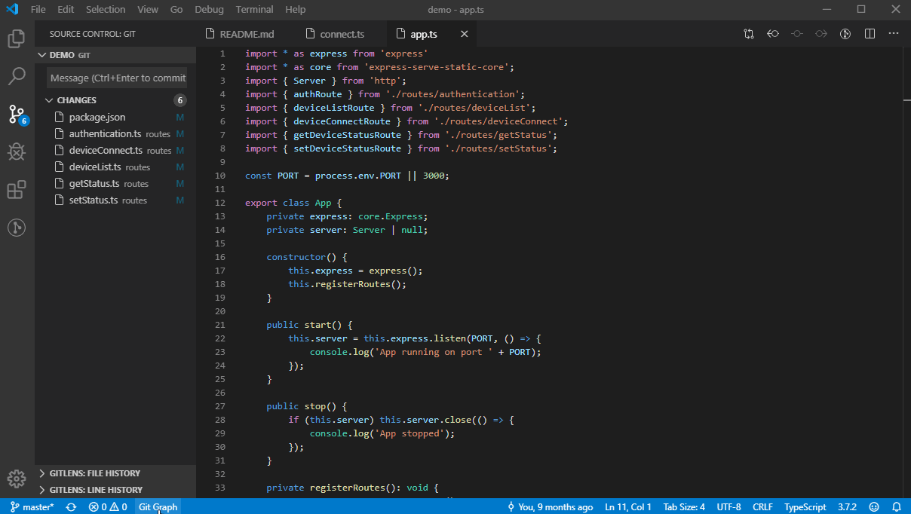

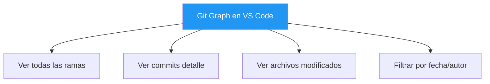

### 5.2.3. Otras extensiones útiles

| Extensión | Función |
|-----------|---------|
| **Gitmoji** | Usar emojis en commits |
| **Git History** | Ver historial detallado de archivos |
| **GitLab Workflow** | Integración GitLab |
| **GitHub Pull Requests** | Gestionar PRs desde VS Code |
| **Remote Repositories** | Editar repositorios remotos directamente |

## 5.3. GitHub CLI

**GitHub CLI** (`gh`) permite gestionar GitHub desde la terminal.

### 5.3.1. Instalación

GitHub CLI se instala en Windows con tu gestor de paquetes favorito, y en macOS y Linux desde homebrew o el repositorio oficial. Verifica la instalación con gh --version antes de continuar.

```bash
# Windows (scoop)
scoop install gh

# Windows (chocolatey)
choco install gh

# macOS
brew install gh

# Linux (Debian/Ubuntu)
sudo apt install gh

# Linux (Fedora)
sudo dnf install gh

# Linux (Arch)
pacman -S github-cli
```

### 5.3.2. Comandos principales

Estos son los comandos que usarás a diario con gh: autenticarte y gestionar pull requests e issues sin salir de la terminal. Empieza por gh auth login: sin sesión, ninguno de los demás funcionará.

```bash
# Autenticarse
gh auth login                    # Login interactivo (HTTPS o SSH)
gh auth status                   # Ver estado de autenticación
gh auth logout                   # Cerrar sesión
gh auth setup-git                # Configurar git para usar gh como credential helper

# Repositorios
gh repo create [nombre] --public     # Crear repo público
gh repo create [nombre] --private    # Crear repo privado
gh repo list                         # Listar tus repos
gh repo view                         # Ver info del repo actual
gh repo clone [usuario/repo]         # Clonar repo

# Pull Requests
gh pr list                    # Listar PRs
gh pr view [PR]               # Ver PR
gh pr create --title "feat: login" --body "Descripción"  # Crear PR con opciones
gh pr create --draft          # Crear PR como borrador
gh pr checkout [PR]           # Cambiar a rama de PR
gh pr merge [PR]              # Fusionar PR (merge commit)
gh pr merge [PR] --squash     # Squash and merge
gh pr merge [PR] --rebase     # Rebase and merge
gh pr review [PR] --approve   # Aprobar PR
gh pr diff [PR]               # Ver diff de la PR
gh pr checks [PR]             # Ver estado de CI/CD

# Issues
gh issue list                 # Listar issues
gh issue view [issue]         # Ver issue
gh issue create --title "Bug: login" --label "bug, P0"  # Crear issue con opciones
gh issue close [issue]        # Cerrar issue
gh issue reopen [issue]       # Reabrir issue

# GitHub Actions (CI/CD)
gh workflow list              # Listar workflows
gh workflow run [workflow]    # Ejecutar workflow
gh run list                  # Ver ejecuciones recientes
gh run view [run-id]         # Ver detalle de una ejecución
gh run watch [run-id]        # Ver ejecución en tiempo real
gh run cancel [run-id]       # Cancelar ejecución

# Búsqueda
gh search repos [query]      # Buscar repositorios
gh search issues [query]     # Buscar issues
gh search code [query]       # Buscar en código

# API personalizada
gh api repos/{owner}/{repo}/actions/runs  # Llamada API directa

# Releases y Gist
gh release list               # Listar releases
gh release create v1.0.0      # Crear release
gh gist list                  # Listar gists
gh gist create archivo.cs     # Crear gist desde archivo

# Configuración
gh alias set prs 'pr list --state open'  # Crear alias personalizado
gh config set editor code                 # Configurar editor por defecto

# Repository
gh repo view                  # Ver repo
gh repo clone [repo]          # Clonar repo
gh repo fork [repo]           # Fork repo
```

### 5.3.3. Ejemplo de flujo completo

Vamos a unirlo todo en un flujo real: clonar con gh, crear rama, commitear, subir y abrir la pull request en un par de comandos. Prueba este guion completo en un repositorio de práctica para consolidar el circuito.

```bash
# Clonar repo
gh repo clone usuario/repo

# Crear rama
git checkout -b feature/nueva

# Trabajar y commit
git add .
git commit -m "feat: nueva funcionalidad"

# Subir y crear PR
git push -u origin feature/nueva
gh pr create --title "feat: nueva funcionalidad" --body "Descripción..."

# Ver estado de PR
gh pr view

# Aprobar PR (como revisor)
gh pr review --approve

# Fusionar PR
gh pr merge --merge
```

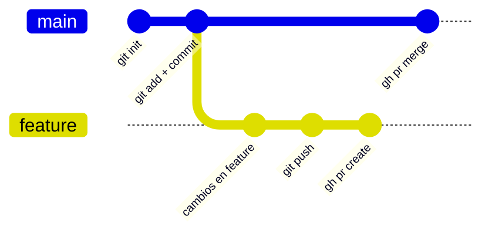


## 5.4. Recursos de aprendizaje

### 5.4.1. Tutoriales interactivos

| Recurso | Descripción | Nivel |
|---------|-------------|-------|
| [Learn Git Branching](https://learngitbranching.js.org) | Tutorial interactivo visual | Principiante |
| [Git Immersion](https://gitimmersion.com) | Tutorial paso a paso | Principiante |
| [GitKatas](https://github.com/praqma-training/git-katas) | Ejercicios prácticos | Todos |
| [GitHub Learning Lab](https://lab.github.com) | Cursos de GitHub | Principiante |

### 5.4.2. Documentación oficial

| Recurso | Descripción |
|---------|-------------|
| [Git Documentation](https://git-scm.com/doc) | Documentación oficial |
| [Git Pro Book](https://git-scm.com/book/es/v2) | Libro completo de Git |
| [GitHub Docs](https://docs.github.com) | Documentación GitHub |
| [GitLab Docs](https://docs.gitlab.com) | Documentación GitLab |

### 5.4.3. Cheat sheets

| Recurso | Descripción |
|---------|-------------|
| [Git Cheat Sheet](https://education.github.com/git-cheat-sheet-education.pdf) | Sheet oficial de GitHub |
| [Git Cheatsheet](https://ndpsoftware.com/git-cheatsheet.html) | Visual interactivo |
| [Git Command Explorer](https://git-cheatsheet.com) | Búsqueda por comando |

### 5.4.4. Juegos y gamificación

| Recurso | Descripción |
|---------|-------------|
| [Oh My Git!](https://ohmygit.org) | Juego para aprender Git |
| [Git Tower Game](https://www.git-tower.com/learn/git/commands/game) | Juego de comandos |
| [Learning Git with Jupyter](https://github.com/jupyterlab/jupyterlab-git) | Git en Jupyter |

## 5.5. Configuración avanzada

> 💡 **Solo lo esencial:** Estos son los ajustes más útiles. No necesitas memorizarlos todos — usa esta sección como referencia rápida.

**Alias útiles (configurar con `git config --global`):**

```bash
git config --global alias.st status
git config --global alias.co checkout
git config --global alias.br branch
git config --global alias.ci commit
git config --global alias.df diff
git config --global alias.lg "log --oneline --graph --all"
```

**El ajuste más importante:** Configurar VS Code como editor por defecto:

```bash
git config --global core.editor "code --wait"
```

> 📝 **Nota:** Los alias son como atajos de teclado: en lugar de escribir `git status`, puedes escribir `git st`. Útiles cuando escribes muchos comandos al día.

## 5.6. Errores comunes y soluciones

### 5.6.1. Errores típicos

| Error | Causa | Solución |
|-------|-------|----------|
| "fatal: not a git repository" | No estás en un repo Git | `git init` o `git clone` |
| "nothing to commit, working tree clean" | No hay cambios | Modifica archivos |
| "changes not staged for commit" | Cambios sin preparar | `git add` |
| "commit nothing to commit" | Todo ya commiteado | Crea nueva rama |
| "failed to push some refs" | El remoto tiene cambios nuevos | `git pull` primero |
| "merge conflict" | Dos personas modificaron lo mismo | Resolver conflictos |
| "detached HEAD" | Checkout a commit, no rama | `git checkout rama` |

### 5.6.2. Recuperación de errores

Cuando algo sale mal (un reset --hard precipitado, un archivo eliminado sin querer), Git guarda pistas para recuperarlo casi todo. Estos comandos son los primeros auxilios: busca en el reflog el estado anterior y restaura desde ahí.

```bash
# Recuperar cambios después de reset --hard
git reflog                    # Ver historial
git reset --hard HEAD@{n}     # Restaurar

# Recuperar archivo eliminado
git restore archivo.txt

# Recuperar commit eliminado
git reflog
git cherry-pick [commit-hash]

# Deshacer último commit (soft)
git reset --soft HEAD~1

# Ver qué commit eliminó algo
git log --all --full-history -- archivo.txt
```

### 5.6.3. Comandos de emergencia

Esta es la caja de herramientas de última instancia: recorrer todo el historial incluidos los resets, buscar un commit por su mensaje o rastrear objetos sueltos con git fsck. Léelos con calma; cuando los necesites de verdad, te alegrarás de conocerlos.

```bash
# Ver todo el historial (incluido resets)
git reflog

# Buscar commit por mensaje
git log --all --grep="mensaje"

# Buscar commit que modificó una línea
git log -S "texto buscado"

# Recuperar archivo de cualquier commit
git checkout [commit-hash] -- archivo.txt

# Ver todos los commits de todas las ramas
git log --all --oneline --graph

# Encontrar "perdido" commit
git fsck --lost-found
```


> 💡 **Buenas Prácticas:**
> - **Instala siempre VS Code + GitLens + GitHub CLI** como punto de partida. Son las herramientas más usadas en la industria y te cubren el 90% de necesidades.
> - **Configura tu editor de Git antes de empezar:** `git config --global core.editor "code --wait"` evita problemas con mensajes de commit.
> - **Usa clientes gráficos si prefieres visual:** GitKraken para aprendizaje, GitHub Desktop para simplicidad. No hay una herramienta "mejor", la que te haga productivo es la correcta.
> - **Aprende los comandos básicos de terminal** aunque uses GUI. Habrá momentos (CI/CD, scripts, merge conflicts) donde necesitarás la línea de comandos.

**Resumen del punto:**

| Herramienta | Descripción |
|-------------|-------------|
| **GitKraken** | Cliente gráfico multiplataforma, visual intuitivo |
| **GitHub Desktop** | Cliente oficial de GitHub, simple y limpio |
| **Sourcetree** | Cliente gratuito de Atlassian, potente |
| **GitLens** | Extensión VS Code con blame, historial y annotations |
| **Git Graph** | Extensión VS Code para visualizar ramas como gráfico |
| **GitHub CLI** | Terminal para gestionar GitHub directamente |
| **gitref.com** | Referencia rápida de comandos |
| **Oh My Zsh** | Framework de terminal con plugins de Git |
| **Oh My Posh** | Temas para la terminal con iconos y colores |

En el Resumen consolidaremos todo lo aprendido en la unidad: conceptos, comandos, flujos de trabajo y herramientas.

**¿Qué viene después?**

En la **UD04: Diseño Orientado a Objetos: Diagrama de Clases** usarás Git para versionar tus diagramas UML y el diseño de clases. Las herramientas que aprendiste aquí (ramas, commits, PRs) te permitirán iterar sobre diseños sin perder versiones anteriores.

| Tema de la UD actual | Se usa en la siguiente UD para |
|----------------------|-------------------------------|
| Clientes GUI y extensiones | Visualizar cambios en diagramas UML |
| GitHub CLI | Automatizar tareas de versionado de diseño |
| Configuración avanzada | Personalizar tu entorno para modelado |
| Errores comunes | Recuperar versiones de diagramas borrados |

## Ejercicio rápido: configurar tu estación de desarrollo

> 📝 **Escenario:** Vas a montar tu entorno de desarrollo completo para trabajar en `cafeteria-web`. Instalarás las herramientas y configurarás VS Code.

**Pasos:**

1. **Instalar las herramientas básicas:**
   - Instala [VS Code](https://code.visualstudio.com) si no lo tienes
   - Instala [Git for Windows](https://git-scm.com) (durante la instalación, acepta las opciones por defecto)
   - Instala GitHub CLI: `scoop install gh` (necesitas [scoop](https://scoop.sh) previamente) o descárgalo desde [cli.github.com](https://cli.github.com)

2. **Configurar Git:**
   ```bash
   git config --global user.name "Tu Nombre"
   git config --global user.email "tu.email@ejemplo.com"
   git config --global core.editor "code --wait"
   ```

3. **Instalar extensiones en VS Code:**
   - Abre VS Code → Extensionses (Ctrl+Shift+X)
   - Busca e instala: **GitLens**, **Git Graph**, **GitHub Pull Requests**

4. **Autenticarse en GitHub CLI:**
   ```bash
   gh auth login
   # Seleccionar: GitHub.com → HTTPS → Login con navegador
   gh auth status  # Verificar que funciona
   ```

5. **Probar que todo funciona:**
   ```bash
   # Crear un repositorio de prueba
   mkdir cafeteria-web-test
   cd cafeteria-web-test
   git init
   echo "# Menú de la cafetería" > README.md
   git add .
   git commit -m "feat: archivo inicial"
   gh repo create cafeteria-web-test --public --source=. --push
   ```

> 💡 **Consejo:** Si `gh auth status` muestra "Logged in", todo está configurado correctamente. Ya puedes usar GitHub desde la terminal sin abrir el navegador.

## 5.7. Personalizar la terminal: Oh My Posh y Nerd Fonts

**Oh My Posh** es un motor de temas para la terminal que muestra iconos, colores e información útil como la rama de Git actual, el directorio, el estado de los archivos, etc.

Para que los iconos se vean correctamente necesitas una **fuente Nerd Font**. Las Nerd Fonts son fuentes programadas con miles de iconos extra (git, Docker, flechas, carpetas, etc.) que Oh My Posh usa para decorar la terminal.

**Así se queda tu terminal**

Antes de tocar nada, el prompt de PowerShell es una línea seca con la ruta:

```text
PS C:\Users\ana\proyecto-web>
```

Después de instalar Oh My Posh y elegir tema, esa misma terminal queda así —con la ruta, el estado de Git, los cambios pendientes, la versión de Node y la hora en una sola línea:


Y así se ve el prompt de cerca; fíjate en el icono de la rama y en los indicadores `↑1 +2 ~1` (un commit por subir, dos añadidos, uno sin confirmar):


Y no hay un solo estilo: cada tema cambia por completo el aspecto. Este es el mismo prompt con el tema *PowerLevel10k Modern*:


> 📝 **Nota:** El prompt se actualiza solo. Si haces `git add`, verás el contador cambiar en cuanto vuelvas a pulsar Enter; si cambias de rama, cambia el nombre. Esa es la diferencia entre una terminal decorada y una terminal que te informa.

**Instalación en Windows:**

```bash
# Instalar Oh My Posh con scoop
scoop install oh-my-posh

# Instalar una nerd font (por ejemplo, firacode)
scoop install FiraCode-NF
```

**Instalación en macOS:**

```bash
# Instalar Oh My Posh con brew
brew install oh-my-posh

# Instalar una nerd font
brew install --cask font-fira-code-nerd-font
```

**Instalación en Linux (Ubuntu/Debian):**

```bash
# Descargar e instalar Oh My Posh
curl -s https://ohmyposh.dev/install.sh | bash

# Descargar una nerd font desde https://www.nerdfonts.com/font-downloads
# Elige la fuente que prefieras (firacode, jetbrainsmono, cascadia Code, etc.)
mkdir -p ~/.local/share/fonts
cd ~/.local/share/fonts
curl -fLO https://github.com/ryanoasis/nerd-fonts/raw/latest/FiraCode.zip
unzip FiraCode.zip
rm FiraCode.zip
fc-cache -fv
```

**Configurar la fuente en tu terminal:**

- **Windows Terminal:** Ve a Configuración → Perfil → Apariencia → Fuente → selecciona "FiraCode Nerd Font"
- **VS Code:** Añade en `settings.json`:
  ```json
  "terminal.integrated.fontFamily": "FiraCode Nerd Font"
  ```
- **PowerShell:** Ve a Propiedades → Fuente → selecciona "FiraCode Nerd Font"

> ⚠️ **Sin la Nerd Font**, Oh My Posh mostrará caracteres raros o cuadros en lugar de iconos. Siempre instala primero la fuente y luego configúrala en la terminal.

> 💡 **Consejo:** Descarga las fuentes desde [nerdfonts.com](https://www.nerdfonts.com/font-downloads). Otras Nerd Fonts populares son **JetBrainsMono Nerd Font**, **Cascadia Code Nerd Font** y **Hack Nerd Font**. Elige la que más te guste.
