<div class="flex items-center gap-4 w-full">
  
  <span class="ud-pill">Entornos de Desarrollo · 1DAW · Curso 2026-2027</span>
</div>

# Sistema de control de versiones

### Registra cambios, comparte código y colabora con Git

<div class="mt-10 flex items-end justify-between w-full">
  <div class="text-left">
    <b class="text-lg">José Luis González Sánchez</b><br/>
    <span class="opacity-70">IES Luis Vives · Leganés · <a href="https://joseluisgs.dev">joseluisgs.dev</a></span>
  </div>
  <PacMan :size="54" label="Preparando el repositorio..." />
</div>

---

## 📦 Materiales de la unidad

Todo el material de la UD03 está publicado en el repositorio de GitHub, organizado por carpetas:

<div class="grid grid-cols-2 gap-6 items-start">
<div>

- 📚 **7 puntos** — teoría, ejemplos y repaso
- 📝 **Prácticas** — trabajo local y colaborativo en `practicas/`
- 💻 **Soluciones** — proyectos en `soluciones/`
- ⌨️ **Chuletas** — referencias rápidas en `chuletas/`
- 🎬 **Vídeos** — lista de reproducción en YouTube

</div>
<div class="flex flex-col items-center justify-center gap-4 pt-4">

<RepoBadge caption="Repositorio con materiales de la unidad" />

<div class="text-sm opacity-75 text-center max-w-55">

Clónalo, forquéalo o descárgalo en zip: el material siempre está a un clic.

</div>
</div>
</div>

---

## 🎯 Resultados de aprendizaje: RA 4

<RaaCcee
  code="RA 4"
  title="Optimiza código empleando las herramientas disponibles en el entorno de desarrollo."
  :letters="['f', 'h', 'i']"
  :ccee="[
    'Se ha realizado el control de versiones integrado en el entorno de desarrollo.',
    'Se han utilizado repositorios remotos para el desarrollo de código colaborativo.',
    'Se han utilizado herramientas para la integración continua del código.',
  ]"
/>

---

## 📚 Índice: los 7 puntos del tema

<div class="grid grid-cols-2 gap-3">

<TopicCard :num="1" title="Git inicial" desc="Historial y cambios" />
<TopicCard :num="2" title="Git avanzado" desc="Ramas y fusiones" />
<TopicCard :num="3" title="Git remoto" desc="Sincronización y versiones" />
<TopicCard :num="4" title="Colaboración" desc="PR, revisión y CI" />
<TopicCard :num="5" title="Herramientas y recursos" desc="IDE, clientes y CLI" />
<TopicCard :num="6" title="Guía de emergencia Git" desc="Recuperación segura" />
<TopicCard :num="7" title="Resumen y conclusiones" desc="Mapa, errores y checklist" />

</div>

---
layout: section
---

<div class="ud-section-number">01</div>

# Git inicial

<div class="opacity-70">Registra y consulta los cambios de un proyecto</div>

---

## 1 · Punto de partida

<div class="grid grid-cols-2 gap-5 items-start">
<div>

<TipBox type="consejo" title="Punto de partida">

Has modificado un programa y ya no funciona. ¿Cómo puedes saber qué cambió y recuperar una versión anterior?

</TipBox>

<TipBox type="nota">

Git registra el historial que decides guardar y permite revisar cómo evoluciona el proyecto.

</TipBox>

</div>
<div>

<Objetivos :items="[
  'Entender repositorio, commit, staging y HEAD',
  'Configurar Git y crear un repositorio',
  'Preparar cambios y consultar el historial',
  'Deshacer cambios, ignorar archivos y usar etiquetas',
]" />

</div>
</div>

---

## 🧭 ¿Qué es el control de versiones?

Un sistema de control de versiones registra la evolución de los archivos. Con él puedes comparar versiones, localizar cambios y coordinar el trabajo de varias personas.

<div class="grid grid-cols-2 gap-5 items-start">
<div>

<ConceptCard icon="📦" title="Git" accent="blue">

Es un sistema **distribuido**: cada clon habitual dispone de un repositorio local y puede registrar commits sin conexión.

</ConceptCard>

Un clon puede tener un historial limitado si se ha realizado con opciones de clonación superficial.

</div>
<div>

<ConceptCard icon="📚" title="Historial" accent="green">

Los commits relacionan instantáneas con información como autor, fecha y mensaje.

</ConceptCard>

Consultar el historial permite identificar qué cambio introdujo un problema.

</div>
</div>

---

## 📁 Repositorio y commit

Un **repositorio** guarda los objetos y referencias de Git; el directorio de trabajo contiene los archivos que editas.

<div class="grid grid-cols-2 gap-5 items-start">
<div>

<ConceptCard icon="📷" title="Commit" accent="blue">

Registra una instantánea del proyecto preparado, junto con metadatos y enlaces a sus commits anteriores.

</ConceptCard>

El mensaje debe explicar el cambio: por ejemplo, `Añade validación del menú`.

</div>
<div>

<ConceptCard icon="🔑" title="Identificador" accent="purple">

El hash identifica un objeto Git. Si cambia su contenido o sus metadatos, también cambia su identificador.

</ConceptCard>

Suele mostrarse una abreviatura, como `a1b2c3d`, para consultar el historial.

</div>
</div>

---

## 🔄 Las tres zonas de trabajo

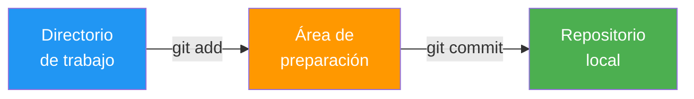

Edita archivos, selecciona qué cambios incluir y confirma la instantánea. **Preparar no es confirmar**: aún puedes revisar o retirar cambios del staging.

<TipBox type="nota">

`HEAD` normalmente apunta a la rama actual; en estado *detached HEAD* apunta directamente a un commit.

</TipBox>

---

## 🧭 ¿Qué contiene cada zona?

<div class="grid grid-cols-2 gap-5 items-start">
<div>

**Directorio de trabajo:** los archivos que ves y editas. Un cambio aquí todavía no forma parte del próximo commit.

**Staging o índice:** la versión seleccionada para la próxima instantánea. Puedes preparar solo algunos archivos.

</div>
<div>

**Historial local:** los commits guardados en `.git`. El último commit de la rama activa se consulta mediante `HEAD`.

**Remoto:** otro repositorio con el que intercambias commits; no recibe automáticamente tus ediciones.

</div>
</div>

---

## 🔁 Del archivo al historial y al remoto

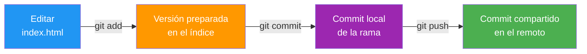

Cada flecha representa una operación distinta. `git add` no crea un commit; `git commit` no hace `push`. En cualquier momento puedes comprobar el estado con `git status`.

---

## 📋 Estados de un archivo

| Estado | Qué significa | Acción habitual |
|---|---|---|
| **Untracked** | Git aún no sigue el archivo | Añadirlo si debe versionarse |
| **Modified** | Cambió desde la última versión | Revisar con `git diff` |
| **Staged** | Su contenido está preparado | Revisar y crear un commit |
| **Committed** | Forma parte de una instantánea | Consultar el historial |

Un archivo puede tener cambios **preparados y sin preparar a la vez** si se edita de nuevo después de `git add`.

---

## ⚙️ Instalar y configurar Git

Comprueba que Git está instalado y configura la identidad que aparecerá en tus commits:

```bash
git --version
git config --global user.name "Tu nombre"
git config --global user.email "tu@email.ejemplo"
git config --global --list
```

<TipBox type="consejo">

Usa una dirección adecuada para tu cuenta y proyecto. `--global` afecta a tu usuario; la configuración local puede sobrescribirla.

</TipBox>

---

## ⚙️ Configuración global y local

Git combina varios niveles de configuración. En caso de conflicto, la opción **local del repositorio** prevalece sobre la global del usuario.

```bash
git config --global init.defaultBranch main
git config --global core.editor "code --wait"
git config --global --list
git config --local user.email "equipo@ejemplo.com"
```

La primera línea establece la rama inicial de futuros repositorios; la última afecta únicamente al repositorio actual.

---

## 📄 La configuración en `.gitconfig`

Las preferencias globales suelen guardarse en `~/.gitconfig`; las específicas del repositorio, en `.git/config`.

```ini
[user]
    name = Ana
    email = ana@ejemplo.com
[init]
    defaultBranch = main
```

`git config --list --show-origin` permite ver los valores y de qué archivo proceden. Así puedes detectar una configuración local que sobrescribe la global.

---

## 🆕 Crear o clonar un repositorio

<div class="grid grid-cols-2 gap-5 items-start">
<div>

**Proyecto nuevo:** inicializa Git en una carpeta existente.

```bash
git init
git status
```

La carpeta `.git` contiene los datos del repositorio. No la elimines si quieres conservar su historial local.

</div>
<div>

**Proyecto existente:** clona un repositorio accesible.

```bash
git clone https://github.com/ana/web.git
cd web
```

La clonación suele configurar el remoto `origin` automáticamente.

</div>
</div>

---

## 🔎 Leer la salida de `git status`

Tras editar `index.html` y crear `menu.html`, Git puede mostrar:

```text
Changes not staged for commit:
  modified:   index.html
Untracked files:
  menu.html
```

El primer archivo ya está **seguido** pero su edición no está preparada; el segundo aún no está seguido. `git status` indica la rama y separa ambos grupos.

<TipBox type="consejo">

Ejecuta `git status` antes y después de preparar cambios para comprobar el resultado.

</TipBox>

---

## 📋 `status` después de preparar

Si ejecutamos `git add index.html`, el archivo aparece en **Changes to be committed**. El nuevo `menu.html` sigue en **Untracked files** si aún no lo hemos añadido.

```text
Changes to be committed:
  modified:   index.html
Untracked files:
  menu.html
```

El commit registrará la versión preparada de `index.html`, no incluirá `menu.html`. Si vuelves a editar `index.html`, `status` puede mostrarlo en ambos grupos.

---

## ➕ `git add`: seleccionar lo que se confirma

```bash
git add index.html
git add menu.html
git diff --staged
git status
```

`git add` copia el estado actual de esos archivos al **índice**. Si vuelves a editar `index.html`, la nueva edición queda sin preparar hasta que repitas el comando.

`git add .` prepara cambios bajo el directorio actual; revisa antes qué incluye. `git add -u` prepara modificaciones y borrados de archivos seguidos, no archivos nuevos.

---

## 🧪 Ejemplo: dos cambios, dos commits

En la web de la cafetería, separa la página inicial de la carta para que cada commit tenga un propósito:

```bash
git add index.html
git commit -m "Añade la página principal"
git add carta.html
git commit -m "Añade la carta de bebidas"
git log --oneline
```

Si luego necesitas revisar la carta, puedes localizar su commit sin mezclarlo con la creación inicial.

---

## 🌳 El historial de esos dos commits

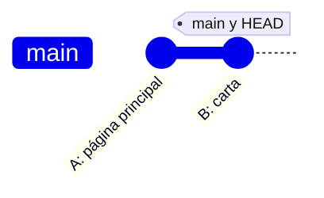

A es el primer commit; B, el segundo. `git add carta.html` prepara cambios, pero no crea commits.

---

## ✍️ Del cambio al commit

Después de editar un archivo, revisa qué ha cambiado y prepara únicamente lo que deseas guardar:

```bash
git status
git diff
git add Program.cs
git diff --staged
git commit -m "Añade el cálculo del total"
```

<TipBox type="advertencia">

Un commit es **local**. Antes de confirmar, comprueba los archivos preparados y evita incluir credenciales o archivos generados.

</TipBox>

---

## 🔍 Comparar y consultar el historial

<div class="grid grid-cols-2 gap-5 items-start">
<div>

```bash
git diff
git diff --staged
```

El primer comando compara los cambios no preparados; el segundo muestra lo que entrará en el próximo commit.

</div>
<div>

```bash
git log --oneline --graph --all
git show HEAD
```

El historial ayuda a seguir las ramas; `git show` muestra los detalles del commit indicado.

</div>
</div>

---

## 🔍 Interpretar un diff

```diff
-<p>Café: 2 €</p>
+<p>Café: 2,50 €</p>
```

La línea con `-` representa el contenido anterior y la línea con `+` el nuevo. `git diff` compara el directorio de trabajo con el índice; `git diff --staged`, el índice con `HEAD`.

Para acotar la revisión, usa `git diff -- index.html`. Los archivos nuevos sin seguimiento aún no aparecen en `git diff` hasta prepararlos.

---

## 🔎 `diff`: tres comparaciones útiles

```bash
git diff
git diff --staged
git diff HEAD
```

Cada comando compara dos zonas distintas del ciclo de cambios:

| Comando | Compara |
|---|---|
| `diff` | Directorio de trabajo ↔ índice |
| `diff --staged` | Índice ↔ último commit |
| `diff HEAD` | Directorio de trabajo ↔ último commit |

Para comparar commits: `git diff A B`; el orden va del estado anterior `A` al nuevo `B`.

---

## 🌳 El historial es un grafo de commits

<div class="w-full mx-auto max-w-150">

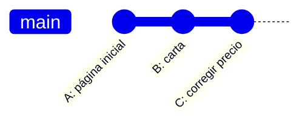

</div>

Cada punto es un **commit real**, no una operación como `add` o `push`. Las líneas indican relaciones de ascendencia: C tiene como padre a B, y B a A.

```bash
git log --oneline --graph --all
git show HEAD
```

---

## 🏷️ HEAD y referencias

Habitualmente `HEAD` señala la rama activa, y la rama señala su último commit:

```text
HEAD → main → C ← B ← A
```

Cuando creas un commit D en `main`, la referencia de `main` avanza a D. Si inspeccionas un commit directamente puedes entrar en **detached HEAD**: los commits que hagas no avanzan automáticamente una rama.

<TipBox type="truco">

Si quieres conservar trabajo hecho desde un commit concreto, crea una rama antes de continuar.

</TipBox>

---

## ↩️ Retirar o descartar cambios

La operación depende de **dónde está el cambio** y de si quieres conservarlo.

| Necesidad | Comando | Resultado |
|---|---|---|
| Retirar del staging | `git restore --staged archivo` | Conserva la edición |
| Descartar edición no preparada | `git restore archivo` | Recupera la versión del índice |
| Deshacer un commit compartido | `git revert <commit>` | Crea un commit inverso |

<TipBox type="advertencia">

`git restore archivo` puede perder cambios locales no guardados. Revisa `git status` y `git diff` antes de usarlo.

</TipBox>

---

## ↩️ `restore`: ¿qué versión recupera?

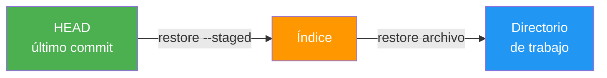

`git restore --staged menu.html` recupera en el índice la versión de `HEAD`, pero mantiene la edición en disco. `git restore menu.html` reemplaza la edición en disco por la versión del índice.

---

## 🧪 Ejemplo: retirar del staging

```bash
git add menu.html
git status
git restore --staged menu.html
git status
```

Después del primer `add`, el cambio estaba preparado. `restore --staged` lo retira del próximo commit, pero **el contenido modificado sigue en el archivo**.

<TipBox type="advertencia">

Sin `--staged`, `git restore menu.html` puede descartar cambios del archivo. Comprueba qué quieres conservar antes de ejecutarlo.

</TipBox>

---

## 👀 `restore`: el historial no cambia

<div class="grid grid-cols-2 gap-5 items-center">
<div>

Partimos de `menu.html` con «Café: 2 €» en el commit y «Café: 3 €» en el índice y el archivo.

`restore` cambia el contenido seleccionado, pero no crea ni quita commits: `main` y `HEAD` siguen en B.

</div>
<div>

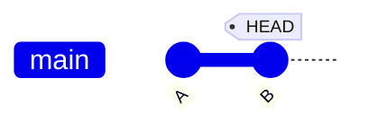

</div>
</div>

| Después de... | Índice | Archivo | Historial |
|---|---|---|---|
| `restore --staged menu.html` | 2 € | 3 € | Sigue en B |
| `restore menu.html` | 2 € | 2 € | Sigue en B |

Son dos pasos consecutivos, no dos formas equivalentes: el segundo descarta la edición de 3 €.

---

## 🔄 `reset`: mover la referencia actual

<div class="w-full mx-auto max-w-150">

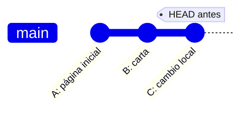

</div>

En una rama local, `git reset --soft HEAD~1` mueve la referencia de C a B. El commit C deja de estar en la historia de esa rama, pero sus cambios quedan preparados.

El comando **reescribe la referencia**; úsalo para trabajo local que no se haya compartido.

---

## 🧮 `reset`: soft, mixed y hard

Suponiendo un último commit local C que queremos retirar de la rama:

| Opción | Rama / HEAD | Índice | Directorio de trabajo |
|---|---|---|---|
| `--soft` | Retrocede | Conserva lo preparado | Conserva archivos |
| `--mixed` | Retrocede | Se ajusta al destino | Conserva archivos |
| `--hard` | Retrocede | Se ajusta al destino | Descarta cambios afectados |

`--mixed` es la opción por defecto. **`--hard` puede perder ediciones sin guardar**; ninguno de estos modos es la primera opción para deshacer trabajo compartido.

---

## 🧪 `reset`: mismo punto de partida

En cada ejemplo siguiente partimos de una copia independiente, con el directorio limpio:

<div class="grid grid-cols-2 gap-5 items-center">
<div>

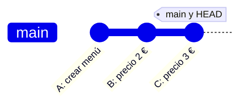

</div>
<div>

En C, el último commit, el índice y `menu.html` contienen «3 €». Queremos volver a B, donde el precio era «2 €». Cambiaremos el modo para ver qué ocurre en cada zona.

</div>
</div>

---

## 🟢 `reset --soft`: conservar lo preparado

```bash
git reset --soft HEAD~1
```

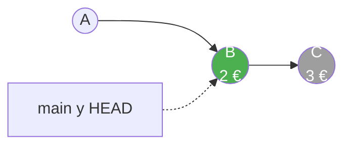

**Después:** `HEAD` apunta a B; índice y archivo siguen con 3 €. La diferencia de precio queda preparada. C ya no está en la historia accesible desde `main`, aunque puede recuperarse durante un tiempo.

---

## 🟠 `reset --mixed`: conservar el archivo

```bash
git reset --mixed HEAD~1
```


**Después:** `HEAD` y el índice contienen 2 €; el archivo conserva 3 €. La diferencia queda **sin preparar**. El historial visible desde `main` es el mismo que con `--soft`.

---

## 🔴 `reset --hard`: descartar cambios afectados

```bash
git reset --hard HEAD~1
```


**Después:** `HEAD`, índice y archivo vuelven a 2 €. El commit C puede localizarse en el reflog, pero **las ediciones no confirmadas sobrescritas pueden perderse definitivamente**.

---

## 🧪 Comparar `reset --soft` y `--mixed`

<div class="grid grid-cols-2 gap-5 items-start">
<div>

```bash
git reset --soft HEAD~1
git status
```

El commit deja de ser el último de la rama. Los cambios permanecen en el índice, listos para revisarse y confirmarse de nuevo.

</div>
<div>

```bash
git reset --mixed HEAD~1
git status
```

La rama retrocede igual, pero el índice se actualiza al commit de destino. Las ediciones siguen en el directorio de trabajo.

</div>
</div>

Prueba cada alternativa en repositorios separados: ejecutarlas una detrás de otra retrocedería **dos commits**.

---

## 🧾 `revert`: un commit que deshace

Antes de revertir B, la rama termina en el precio erróneo de 3 €:

```text
A: menú ── B: precio 3 €  ← main / HEAD
```

<div class="w-full mx-auto max-w-120">

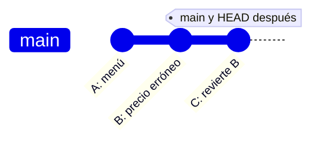

</div>

`git revert <hash-de-B>` crea C con el cambio inverso: vuelve al precio anterior, pero B sigue en la historia. Es apropiado para cambios compartidos; puede haber conflictos si esas líneas cambiaron después.

---

## 🧭 Restore, reset y revert

| Comando | Acción principal | ¿Reescribe la rama? |
|---|---|---|
| `restore archivo` | Restaura contenido en disco o índice | No |
| `reset --soft` | Mueve la rama, conserva índice y archivos | Sí |
| `reset --mixed` | Mueve la rama y actualiza el índice | Sí |
| `reset --hard` | También actualiza archivos en disco | Sí, con riesgo de pérdida |
| `revert` | Añade un commit inverso | No elimina el historial |

Primero pregunta **qué zona quieres cambiar** y si el historial ya se ha compartido.

---

## 🛟 `reflog`: localizar un commit anterior

El reflog local registra movimientos de referencias como `HEAD`. Puede ayudar a encontrar un commit que dejó de estar en la punta tras un reset o rebase:

```bash
git reflog
git show <hash>
git switch -c recuperacion <hash>
```

La nueva rama permite inspeccionar el commit sin desplazar la rama original. No recupera necesariamente cambios que nunca se guardaron, y las entradas caducan según la configuración.

---

## 🚫 Ignorar archivos generados

Un archivo `.gitignore` indica patrones de archivos no seguidos que Git debe ignorar:

```text
bin/
obj/
node_modules/
.env
```

Por ejemplo, no es necesario versionar las carpetas de compilación. **No basta con ignorar un secreto ya confirmado**: hay que tratarlo como comprometido y revocarlo.

<TipBox type="nota">

`.gitignore` no deja de seguir automáticamente un archivo que ya está versionado.

</TipBox>

---

## 🗑️ Dejar de seguir o eliminar un archivo

<div class="grid grid-cols-2 gap-5 items-start">
<div>

```bash
git rm notas.txt
```

Prepara la eliminación del archivo seguido y lo retira del directorio de trabajo. El borrado se incorpora al siguiente commit.

</div>
<div>

```bash
git rm --cached notas.txt
```

Deja el archivo en disco y prepara su retirada del seguimiento. Añade el patrón a `.gitignore` si tampoco debe seguirse en el futuro.

</div>
</div>

Los commits anteriores siguen conservando sus versiones. Ninguna de estas acciones elimina un secreto del historial.

---

## 🏷️ Etiquetas y cambios temporales

<div class="grid grid-cols-2 gap-5 items-start">
<div>

**Etiqueta:** identifica un commit importante, como una versión.

```bash
git tag -a v1.0.0 -m "Versión 1.0.0"
git tag
```

Una etiqueta local no se publica automáticamente al enviar la rama.

</div>
<div>

**Stash:** guarda temporalmente cambios para dejar libre el directorio de trabajo.

```bash
git stash push -m "Trabajo pendiente"
git stash list
git stash apply
```

Por defecto, `stash` no incluye archivos no seguidos; `apply` conserva la entrada.

</div>
</div>

---

## 📌 Stash: guardar y recuperar

La edición de la carta está a medias y necesitas atender una corrección en otra rama. Guarda el trabajo temporalmente y recupera después la entrada:

```bash
git stash push -m "Carta a medias"
git stash list
git stash show -p
git stash pop
```

`show -p` permite inspeccionar el contenido. `pop` aplica y elimina la entrada si se aplica correctamente; `apply` la conserva. Usa `-u` en `stash push` si también necesitas incluir archivos no seguidos.

---

## 🏷️ Etiquetas en el historial

<div class="w-full mx-auto max-w-150">

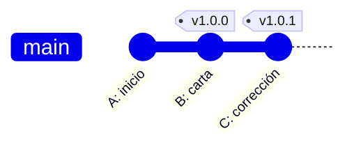

</div>

Una etiqueta apunta a un commit concreto. `git tag -a v1.0.0 -m "Versión estable"` crea una **etiqueta anotada**, con metadatos; `git show v1.0.0` permite verla.

Para compartir esa marca hay que enviarla explícitamente al remoto.

---

## Resumen del punto 1

<div class="grid grid-cols-2 gap-5 items-start">
<div>

| Concepto | Función |
|---|---|
| **Repositorio** | Guarda objetos e historial |
| **Staging** | Selecciona la próxima instantánea |
| **Commit** | Registra cambios localmente |
| **Diff / log** | Revisan cambios e historial |
| **Tag / stash** | Marcan versiones / guardan trabajo |

</div>
<div>

<ConceptCard icon="✅" title="Buenas prácticas" accent="green">

- Comprueba `status` y `diff`
- Prepara solo lo necesario
- Escribe mensajes claros
- No confirmes secretos

</ConceptCard>

<div class="mt-3">

**⏭️ ¿Qué viene después?** En el **punto 2** trabajaremos con ramas y fusiones.

</div>
</div>
</div>

---
layout: section
---

<div class="ud-section-number">02</div>

# Git avanzado

<div class="opacity-70">Organiza cambios con ramas e intégralos con seguridad</div>

---

## 2 · Punto de partida

<div class="grid grid-cols-2 gap-5 items-start">
<div>

<TipBox type="consejo" title="Punto de partida">

Necesitas añadir reservas mientras otra persona corrige el menú. ¿Cómo separáis los cambios y los integráis después?

</TipBox>

<TipBox type="nota">

Una rama permite avanzar desde un commit sin modificar directamente la rama principal.

</TipBox>

</div>
<div>

<Objetivos :items="[
  'Crear y gestionar ramas',
  'Diferenciar merge, rebase y cherry-pick',
  'Resolver conflictos de integración',
  'Comparar flujos de trabajo con ramas',
]" />

</div>
</div>

---

## 🌿 ¿Qué es una rama?

Una rama es una **referencia a un commit** que avanza al crear nuevos commits sobre ella. Distintas ramas pueden compartir historia y después divergir.

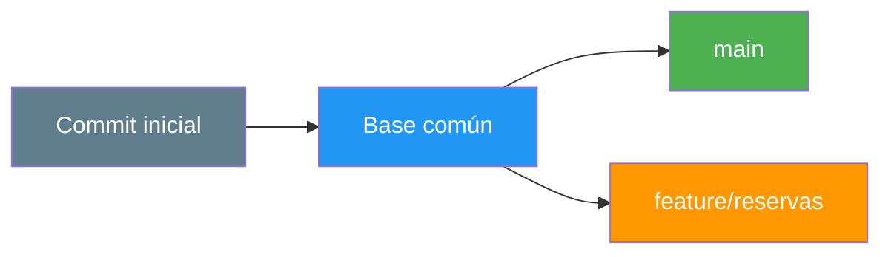

Crear una rama no copia todos los archivos. Al cambiar de rama, Git actualiza el directorio de trabajo cuando puede hacerlo sin perder cambios.

---

## 🌳 Dos ramas que avanzan por separado

<div class="w-full mx-auto max-w-150">

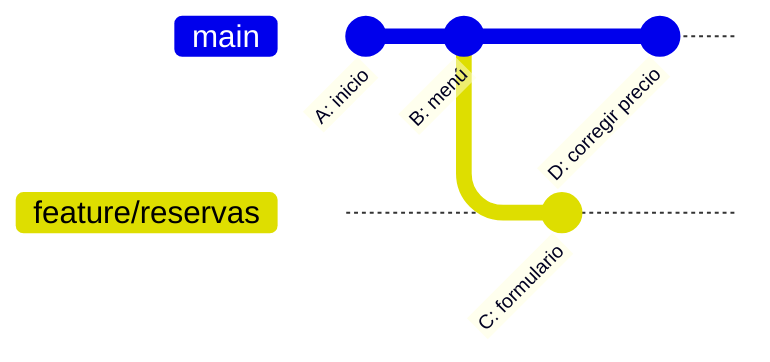

</div>

Ambas ramas comparten A y B. Después, `feature/reservas` incorpora C y `main` incorpora D: cada referencia apunta a su último commit.

El grafo muestra **historia real de commits**; cambiar de rama no crea un commit por sí solo.

---

## 🌱 Crear y cambiar de rama

```bash
git status
git switch main
git switch -c feature/reservas
git branch
```

La nueva rama parte del commit en el que estás situado. Antes de crearla, comprueba que la rama base es la correcta y está actualizada.

<TipBox type="consejo">

Usa nombres descriptivos y ramas pequeñas: facilitan revisar e integrar cada cambio.

</TipBox>

---

## 🌿 Consultar y limpiar ramas

```bash
git branch
git branch -a
git branch -v
git switch feature/reservas
git switch -
```

`branch` lista ramas locales y marca la actual con `*`; `-a` incluye referencias remotas y `-v` muestra el último commit. `switch -` vuelve a la rama anterior.

Cuando una rama ya se ha integrado, `git branch -d feature/reservas` evita borrarla si Git detecta que aún contiene trabajo sin fusionar.

---

## 🔀 Integrar con merge

Para incorporar una funcionalidad, sitúate en la **rama que recibirá** los cambios y ejecuta la fusión:

```bash
git switch main
git merge feature/reservas
git log --oneline --graph --all
```

Si `main` no ha avanzado, puede producirse un **fast-forward**. Si ambas ramas han avanzado, Git puede crear un commit de fusión.

<TipBox type="nota">

Cuando la rama ya está integrada y no se necesita, `git branch -d feature/reservas` permite eliminarla de forma segura.

</TipBox>

---

## ⏩ Fast-forward: avanza la referencia

Antes de fusionar, `main` sigue en B y la rama de reservas ha avanzado hasta D:

<div class="w-full mx-auto max-w-150">

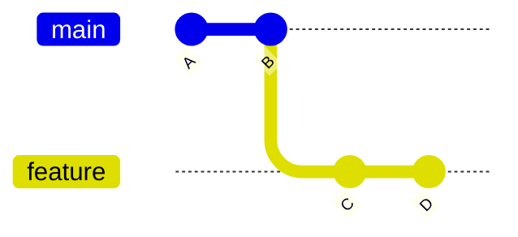

</div>

Al ejecutar `git switch main` y `git merge feature`, si se permite el **fast-forward**, `main` pasa a señalar D. No se crea un commit de fusión.

---

## ⏩ Fast-forward: después del merge

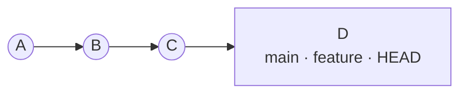

Las dos referencias apuntan al mismo commit D; no hay una integración nueva ni un commit de fusión.

En un fast-forward Git solo mueve `main`: la historia ya incluía C y D. Si ambas ramas avanzaron de forma independiente, no se puede hacer este avance directo.

---

## 🔀 Merge commit: unir historias divergentes

<div class="w-full mx-auto max-w-150">

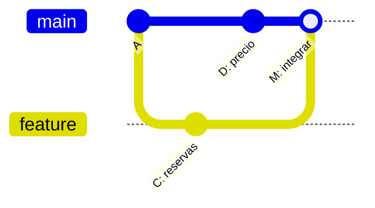

</div>

Ahora ambas ramas avanzaron: M une las dos líneas y tiene **dos padres**, D y C. Con `git merge --no-ff feature` también puedes solicitar un commit de fusión cuando sería posible un fast-forward.

---

## 🧩 ¿Qué es un conflicto?

Git no siempre puede combinar automáticamente cambios incompatibles. En ese caso detiene la operación y marca las zonas que debes revisar.

```text
<<<<<<< HEAD
Precio: 10
=======
Precio: 12
>>>>>>> feature/reservas
```

Decide el contenido correcto, elimina los marcadores y revisa el resultado. Un conflicto es una decisión pendiente, no una pérdida automática de trabajo.

---

## 🛠️ Resolver una fusión paso a paso

1. Consulta los archivos afectados con `git status`.
2. Abre cada conflicto y decide qué cambios conservar.
3. Elimina los marcadores y comprueba el funcionamiento.
4. Prepara los archivos resueltos con `git add`.
5. Completa la fusión con `git commit` si Git lo solicita.

<TipBox type="advertencia">

Si necesitas cancelar una fusión en curso, revisa primero tu estado y utiliza `git merge --abort`. Conserva una copia de cambios importantes antes de actuar.

</TipBox>

---

## 👀 Conflictos en Rider

<div class="grid grid-cols-2 gap-5 items-start">
<div>

Rider permite comparar ambos lados del conflicto y construir el resultado en el editor de fusión.

1. Revisa los cambios de cada rama.
2. Selecciona o edita el resultado.
3. Marca el archivo como resuelto.
4. Prueba el proyecto antes de confirmar.

</div>
<div>


</div>
</div>

---

## 🧭 Rebase y cherry-pick

<div class="grid grid-cols-2 gap-5 items-start">
<div>

<ConceptCard icon="📐" title="Rebase" accent="blue">

Reaplica commits sobre otra base y crea nuevos identificadores. Puede facilitar un historial lineal.

</ConceptCard>

Úsalo con precaución en trabajo local; no reescribas una rama compartida sin acordarlo.

</div>
<div>

<ConceptCard icon="🍒" title="Cherry-pick" accent="green">

Aplica el cambio de un commit concreto en la rama actual como un nuevo commit.

</ConceptCard>

Puede servir para llevar una corrección aislada a otra rama; revisa sus dependencias.

</div>
</div>

---

## 🍒 Cherry-pick: solo un cambio

Base A: `develop` añade B y la corrección C; `main` avanza a D. Queremos copiar solo C:

```bash
git switch main
git cherry-pick <hash-de-C>
```

<div class="grid grid-cols-2 gap-5 items-center">
<div>

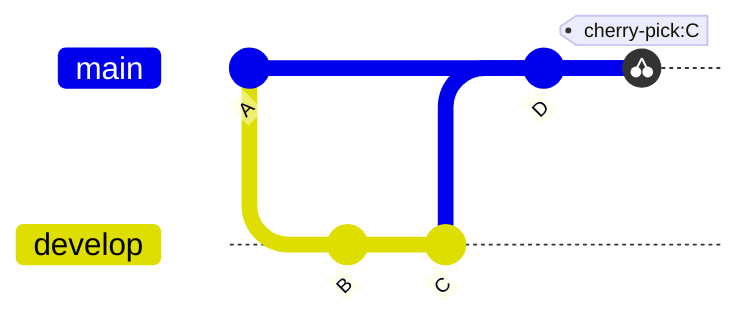

</div>
<div>

`A` es la base; `B` añade una función; `C` corrige un error; `D` avanza `main`. La cereza representa un nuevo commit en `main`: C conserva su sitio en `develop`, B no se integra y el hash de la copia cambia. Úsalo si C no depende de B.

</div>
</div>

---

## 📐 Rebase: antes de reaplicar

<div class="w-full mx-auto max-w-150">

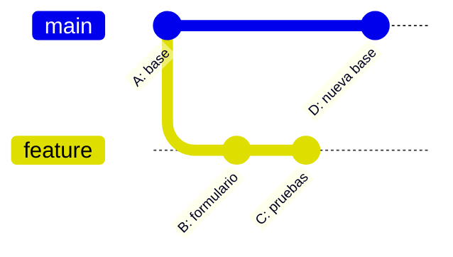

</div>

La rama `feature` parte de A; mientras tanto, `main` ha avanzado a D. Para poner el trabajo local sobre esa nueva base, cambiamos a `feature` y ejecutamos `git rebase main`.

---

## 📐 Rebase: después de reaplicar

<div class="w-full mx-auto max-w-150">

```mermaid
gitGraph
    commit id: "A: base"
    commit id: "D: nueva base"
    branch feature
    checkout feature
    commit id: "B': formulario"
    commit id: "C': pruebas"
```

</div>

Git reaplica los cambios como B' y C': **no son los mismos commits** y sus hashes cambian. Si el rebase se detiene por conflictos, usa `git status`, resuelve, prepara y ejecuta `git rebase --continue`.

---

## 🔍 ¿Qué cambió en el rebase?

<div class="grid grid-cols-2 gap-5 items-start">
<div>

**Antes:** `feature` apuntaba a C y partía de A. `main` avanzó por separado hasta D.

```text
A ── D        main
 \
  B ── C      feature
```

</div>
<div>

**Después:** D pasa a ser la nueva base y `feature` apunta a C'.

```text
A ── D        main
      \
       B' ── C'  feature
```

</div>
</div>

Los cambios se reaplican, pero B' y C' tienen nuevos padres y nuevos hashes. A y D no cambian; los commits originales pueden seguir siendo recuperables durante un tiempo.

---

## 🧪 Rebase paso a paso

Situados en una rama de trabajo **no compartida**, comprobamos el historial y aplicamos la base:

```bash
git switch feature/reservas
git log --oneline --graph --all
git rebase main
```

Git toma los commits propios de la rama y los reaplica sobre el último commit de `main`. El resultado puede diferir si hay conflictos o commits equivalentes; revisa el grafo después.

```bash
git log --oneline --graph --all
```

---

## 🧩 Conflictos durante un rebase

```bash
git status
# Edita y resuelve los archivos indicados
git add menu.html
git rebase --continue
```

El rebase puede detenerse **varias veces**, al reaplicar distintos commits. Tras cada resolución, revisa el contenido antes de continuar.

<TipBox type="advertencia">

`git rebase --abort` cancela el rebase en curso. `--skip` omite el commit que se está aplicando: no lo uses sin entender qué cambios perderías.

</TipBox>

---

## ✂️ Rebase interactivo

Para organizar los últimos tres commits **locales**, puedes abrir una lista editable:

```bash
git rebase -i HEAD~3
```

El editor muestra la lista de commits que se va a reescribir; revisa cada acción antes de guardar y cerrar.

| Acción | Qué permite |
|---|---|
| `pick` | Conservar el commit |
| `reword` | Cambiar su mensaje |
| `squash` | Combinarlo con el anterior |
| `drop` | Eliminarlo del historial reescrito |

Reescribir commits compartidos afecta al equipo; trabaja en un repositorio de prueba y no descartes cambios sin revisarlos.

---

## 🔁 Merge frente a rebase

| Operación | Resultado | Cuándo considerar |
|---|---|---|
| **Merge** | Integra historias; puede crear un commit de fusión | Conservar el contexto de la integración |
| **Rebase** | Reaplica commits sobre otra base | Ordenar trabajo local antes de compartir |

Para actualizar una rama propia aún no compartida, sitúate en ella y usa `main` como nueva base:

```bash
git switch feature/reservas
git rebase main
```

Si aparecen conflictos durante el rebase, resuélvelos, prepara los archivos y usa `git rebase --continue`; para cancelarlo existe `git rebase --abort`.

---

## ⚖️ Tres operaciones, un mismo punto de partida

<div class="w-full mx-auto max-w-135">

```mermaid
gitGraph
    commit id: "A: base"
    branch feature
    checkout feature
    commit id: "B: reservas"
    commit id: "C: corregir horario"
    checkout main
    commit id: "D: actualizar precios"
```

</div>

`feature` contiene B y C; `main` contiene D. En los siguientes ejemplos partimos **siempre de este grafo**, no aplicamos las tres operaciones seguidas. Supondremos que C es independiente de B.

---

## 🔀 Opción 1: integrar todo con merge

```bash
git switch main
git merge feature
```

<div class="grid grid-cols-2 gap-5 items-center">
<div>

```mermaid
gitGraph
    commit id: "A"
    branch feature
    checkout feature
    commit id: "B"
    commit id: "C"
    checkout main
    commit id: "D"
    merge feature id: "M"
```

</div>
<div>

M tiene dos padres, D y C. **Usa merge** cuando quieras integrar toda la rama y conservar explícitamente su historia y el punto de unión.

</div>
</div>

---

## 📐 Opción 2: actualizar la base con rebase

```bash
git switch feature
git rebase main
```

<div class="w-full mx-auto max-w-125">

```mermaid
gitGraph
    commit id: "A"
    commit id: "D"
    branch feature
    checkout feature
    commit id: "B'"
    commit id: "C'"
```

</div>

`feature` apunta ahora a C'; `main` sigue en D. B' y C' son commits nuevos. **Usa rebase** para colocar trabajo propio sobre una base actualizada y facilitar una historia lineal.

---

## 🍒 Opción 3: traer solo un commit

```bash
git switch main
git cherry-pick <hash-de-C>
```

<div class="grid grid-cols-2 gap-5 items-center">
<div>

```mermaid
gitGraph
    commit id: "A"
    branch feature
    checkout feature
    commit id: "B"
    commit id: "C"
    checkout main
    commit id: "D"
    cherry-pick id: "C"
```

</div>
<div>

Git aplica C sobre D como un **nuevo commit** en `main`; B no se integra. Úsalo para una corrección aislada y comprueba sus dependencias. Si hay un conflicto, resuélvelo, ejecuta `git add <archivo>` y `git cherry-pick --continue`; `--abort` cancela la operación.

</div>
</div>

---

## 🧭 ¿Cuál elegir y por qué?

| Si necesitas... | Operación | Resultado |
|---|---|---|
| Integrar la funcionalidad completa | `merge` | Conserva las historias y puede crear una unión |
| Actualizar la base de trabajo local | `rebase` | Reaplica todos los commits de la rama |
| Llevar una corrección aislada | `cherry-pick` | Copia el cambio de un commit concreto |

`rebase` y `cherry-pick` crean commits nuevos. Evita reescribir historia compartida sin acuerdo; si el cambio depende de otros, seleccionarlo solo puede no ser suficiente.

---

## 🗂️ Flujos con ramas

<div class="grid grid-cols-2 gap-5 items-start">
<div>

**GitHub Flow:** rama principal y ramas breves para cambios que se revisan mediante una pull request.

Es sencillo para equipos que integran con frecuencia.

</div>
<div>

**GitFlow:** distingue ramas de desarrollo, funcionalidades, versiones y correcciones urgentes.

Ofrece más estructura, pero requiere mayor coordinación.

</div>
</div>

<TipBox type="consejo">

Elige el flujo según el equipo y las versiones que mantiene; una rama por funcionalidad no sustituye la revisión ni las pruebas.

</TipBox>

---

## 🌱 GitHub Flow en un grafo

<div class="w-full mx-auto max-w-150">

```mermaid
gitGraph
    commit id: "A: base"
    branch feature/reservas
    checkout feature/reservas
    commit id: "B: formulario"
    commit id: "C: pruebas"
    checkout main
    merge feature/reservas id: "D: integrar PR"
```

</div>

La rama se crea desde `main`, agrupa un cambio y se propone mediante una PR. Tras revisión y pruebas, el equipo decide cómo integrar y si eliminar la rama.

---

## 🧭 GitFlow y trunk-based

<div class="grid grid-cols-2 gap-5 items-start">
<div>

**GitFlow** separa `main` y `develop` y contempla ramas `feature`, `release` y `hotfix`. Es útil cuando se coordinan versiones y correcciones por separado.

</div>
<div>

**Trunk-based development** integra cambios pequeños y frecuentes en una rama principal, con ramas de vida corta cuando se necesitan.

</div>
</div>

No existe una estrategia universal: la frecuencia de entrega y las políticas del equipo condicionan la elección.

---

## 🗺️ GitFlow: todas las ramas

```mermaid
graph LR
    M[main<br>versiones estables] --> H[hotfix<br>corrección urgente]
    M --> D[develop<br>integración]
    D[develop<br>integración] --> F[feature<br>funcionalidad]
    F --> D
    D --> R[release<br>preparación]
    R --> M
    R --> D
    H --> M
    H --> D
    style M fill:#4CAF50,color:#fff
    style D fill:#2196F3,color:#fff
    style F fill:#FF9800,color:#fff
    style R fill:#9C27B0,color:#fff
    style H fill:#f44336,color:#fff
```

Las funcionalidades parten de `develop` y vuelven a ella. Una `release` prepara la versión; un `hotfix` parte de `main` y debe llegar también a `develop`.

---

## 🌳 GitFlow: de funcionalidad a release

```mermaid
gitGraph
    commit id: "A" tag: "v1.0"
    branch develop
    checkout develop
    commit id: "B"
    branch feature/carta
    checkout feature/carta
    commit id: "C"
    checkout develop
    merge feature/carta id: "D"
    branch release/1.1
    checkout release/1.1
    commit id: "E"
    checkout main
    merge release/1.1 id: "F" tag: "v1.1"
    checkout develop
    merge release/1.1 id: "G"
```

GitFlow separa desarrollo y publicación. El siguiente grafo muestra el hotfix desde `main`.

---

## 🧭 El papel de cada rama

| Rama | Nace de | Se integra en | Para qué sirve |
|---|---|---|---|
| `main` | — | — | Versiones publicadas |
| `develop` | `main` | — | Integración de la próxima versión |
| `feature/*` | `develop` | `develop` | Desarrollar una funcionalidad |
| `release/*` | `develop` | `main` y `develop` | Preparar una versión |
| `hotfix/*` | `main` | `main` y `develop` | Corregir producción |

`main` y `develop` son ramas duraderas; las demás suelen eliminarse cuando sus cambios ya están integrados.

---

## 🌱 GitFlow: funcionalidad en develop

```mermaid
gitGraph
    commit id: "A: estable" tag: "v1.0"
    branch develop
    checkout develop
    commit id: "B: desarrollo"
    branch feature/carta
    checkout feature/carta
    commit id: "C: carta"
    checkout develop
    merge feature/carta id: "D: integrar carta"
```

La función nace de `develop` y vuelve a él tras probarse; aún no se publica en `main`.

---

## 📦 GitFlow: preparar una release

```mermaid
gitGraph
    commit id: "A: versión estable"
    branch develop
    checkout develop
    commit id: "B: funcionalidades"
    branch release/1.1
    checkout release/1.1
    commit id: "C: ajustes"
    checkout main
    merge release/1.1 id: "D: publicar" tag: "v1.1"
    checkout develop
    merge release/1.1 id: "E: incorporar ajustes"
```

La release sale de `develop`, se publica en `main` y devuelve sus ajustes a `develop`.

---

## 📦 GitFlow: completar la release

Durante la preparación se corrigen errores y se ajustan versión o documentación; las nuevas funcionalidades continúan en `develop`.

```bash
git switch -c release/1.1 develop
# Ajustar y confirmar los cambios de la versión
git switch main
git merge --no-ff release/1.1
git tag -a v1.1 -m "Versión 1.1"
git switch develop
git merge --no-ff release/1.1
```

La etiqueta identifica el commit publicado. Comprueba los cambios y resuelve los posibles conflictos antes de terminar cada fusión.

---

## 🚑 GitFlow: corregir producción

```mermaid
gitGraph
    commit id: "A: versión estable" tag: "v1.1"
    branch develop
    checkout develop
    commit id: "B: próxima versión"
    checkout main
    branch hotfix/1.1.1
    checkout hotfix/1.1.1
    commit id: "C: corrección"
    checkout main
    merge hotfix/1.1.1 id: "D: publicar fix" tag: "v1.1.1"
    checkout develop
    merge hotfix/1.1.1 id: "E: incorporar fix"
```

El hotfix parte de `main` y se integra tanto en `main` como en `develop`.

---

## 🚑 GitFlow: completar el hotfix

```bash
git switch -c hotfix/1.1.1 main
# Corregir, probar y confirmar
git switch main
git merge --no-ff hotfix/1.1.1
git tag -a v1.1.1 -m "Corrección 1.1.1"
git switch develop
git merge --no-ff hotfix/1.1.1
```

Si hay una `release` en curso, la corrección también debe llegar a ella según el flujo acordado, y finalmente a `develop`. Así evitamos que una versión posterior reintroduzca el error.

---

## ⌨️ GitFlow: comandos de una feature

```bash
git switch develop
git switch -c feature/carta
# Editar, revisar y confirmar cambios
git switch develop
git merge --no-ff feature/carta
```

La rama de destino es `develop`: por eso cambiamos a ella antes de fusionar. `--no-ff` solicita un commit de fusión aunque se pudiera avanzar con fast-forward.

La preparación de releases y hotfixes sigue la política de revisión y publicación del equipo.

---

## 🎯 ¿Cuándo compensa GitFlow?

GitFlow asigna un papel a cada rama y encaja cuando hay **versiones planificadas** y es necesario mantener una vía urgente para producción.

Su estructura también exige coordinación: ramas largas y fusiones frecuentes pueden complicar la integración. Para despliegues muy continuos puede encajar mejor un flujo más sencillo.

---

## Resumen del punto 2

<div class="grid grid-cols-2 gap-5 items-start">
<div>

| Concepto | Función |
|---|---|
| **Rama** | Desarrollar desde una base |
| **Merge** | Integrar historias |
| **Rebase** | Reaplicar commits |
| **Cherry-pick** | Aplicar un commit concreto |
| **Conflicto** | Decisión manual de integración |

</div>
<div>

<ConceptCard icon="✅" title="Buenas prácticas" accent="green">

- Comprueba la rama activa
- Mantén ramas pequeñas
- Revisa y prueba las fusiones
- Protege el historial compartido

</ConceptCard>

<div class="mt-3">

**⏭️ ¿Qué viene después?** En el **punto 3** compartiremos los cambios mediante repositorios remotos.

</div>
</div>
</div>

---
layout: section
---

<div class="ud-section-number">03</div>

# Git remoto

<div class="opacity-70">Sincroniza repositorios y comparte versiones</div>

---

## 3 · Punto de partida

<div class="grid grid-cols-2 gap-5 items-start">
<div>

<TipBox type="consejo" title="Punto de partida">

Tus commits están en tu ordenador. ¿Cómo puede otra persona acceder a ellos y aportar cambios?

</TipBox>

<TipBox type="nota">

Un repositorio remoto permite intercambiar commits; no todos los cambios locales se suben automáticamente.

</TipBox>

</div>
<div>

<Objetivos :items="[
  'Diferenciar Git y las plataformas de alojamiento',
  'Configurar y consultar remotos',
  'Distinguir fetch, pull y push',
  'Compartir etiquetas y configurar autenticación',
]" />

</div>
</div>

---

## ☁️ Git no es GitHub

<div class="grid grid-cols-2 gap-5 items-start">
<div>

<ConceptCard icon="🔀" title="Git" accent="blue">

Herramienta distribuida que gestiona repositorios, commits y ramas. Puede trabajar sin conexión.

</ConceptCard>

Un commit crea una instantánea en tu repositorio local, incluso sin cuenta en una plataforma.

</div>
<div>

<ConceptCard icon="🐙" title="GitHub" accent="purple">

Plataforma que aloja repositorios y añade pull requests, issues y automatización.

</ConceptCard>

GitLab y Bitbucket son otras plataformas que también permiten alojar repositorios Git.

</div>
</div>

---

## 🔗 Conocer los remotos

Un remoto es un nombre asociado a una dirección. `origin` suele identificar el repositorio desde el que clonaste; puedes configurar otros.

```bash
git remote -v
git remote add origin https://github.com/usuario/proyecto.git
```

<TipBox type="nota">

El segundo comando se usa si aún no existe `origin`. Si ya existe, comprueba su URL antes de cambiar la configuración.

</TipBox>

---

## 🧭 `origin` no es una rama

```text
origin        → dirección del repositorio remoto
main          → rama local
origin/main   → seguimiento local de la rama remota
```

`git remote -v` muestra las direcciones de descarga y envío. `git branch -vv` permite consultar las ramas locales y sus ramas de seguimiento.

La referencia `origin/main` refleja lo que Git conocía **tras el último fetch**, no necesariamente el estado actual del servidor.

---

## 🗺️ Del repositorio local al remoto

```mermaid
graph LR
    A[Archivos locales] -->|git add| B[Staging]
    B -->|git commit| C[Commits locales]
    C -->|git push| D[Repositorio remoto]
    D -->|git fetch| E[origin/main]
    E -->|git merge| C
    style A fill:#607D8B,color:#fff
    style B fill:#FF9800,color:#fff
    style C fill:#2196F3,color:#fff
    style D fill:#4CAF50,color:#fff
    style E fill:#9C27B0,color:#fff
```

`origin/main` es una **referencia local de seguimiento** del último estado remoto conocido, no la rama `main` de tu directorio de trabajo.

---

## ⬆️ Publicar una rama

Primero confirma los cambios en local; después puedes enviar los commits de la rama al repositorio remoto.

```bash
git status
git push -u origin feature/reservas
```

`-u` establece la rama de seguimiento para simplificar futuras sincronizaciones. Para subir etiquetas, indícalas explícitamente:

```bash
git push origin v1.0.0
```

---

## ⬇️ Fetch y pull

<div class="grid grid-cols-2 gap-5 items-start">
<div>

<ConceptCard icon="📥" title="Fetch" accent="blue">

Descarga información del remoto y actualiza referencias de seguimiento, sin integrar cambios en tu rama.

</ConceptCard>

Tras `git fetch origin`, compara tu rama con `origin/main` antes de decidir.

</div>
<div>

<ConceptCard icon="🔄" title="Pull" accent="green">

Descarga e integra los cambios de la rama remota de seguimiento mediante merge o rebase, según la configuración.

</ConceptCard>

Comprueba el estado y la estrategia del equipo antes de ejecutar `git pull`.

</div>
</div>

---

## 🧪 Inspeccionar antes de integrar

```bash
git fetch origin
git status
git log --oneline --left-right HEAD...origin/main
```

La comparación muestra commits exclusivos de cada lado: `<` corresponde a `HEAD` y `>` a `origin/main`.

<TipBox type="advertencia">

Si un push se rechaza porque la rama remota avanzó, revisa e integra los cambios. No fuerces el envío para ocultar el problema.

</TipBox>

---

## 🔄 Fetch seguido de integración

```bash
git switch main
git fetch origin
git log --oneline main..origin/main
git diff main origin/main
git merge origin/main
```

`fetch` actualiza la referencia `origin/main`. El log muestra commits que están en esa referencia y no en `main`; el diff compara sus contenidos. Solo después decides si integrar.

Si tu rama ha divergido, la fusión puede requerir un commit de merge o resolver conflictos.

---

## 📥 Pull y sus opciones

```bash
git pull origin main
git pull --ff-only origin main
git pull --rebase origin main
```

El primero descarga e integra según la configuración. `--ff-only` rechaza la integración si no puede avanzar en línea recta; `--rebase` reaplica commits locales sobre la base descargada.

<TipBox type="advertencia">

Comprueba siempre qué rama tienes activa: `pull origin main` integra `main` del remoto **en la rama actual**.

</TipBox>

---

## 🔐 HTTPS y SSH

| Método | Cómo se autentica | Precaución |
|---|---|---|
| **HTTPS** | Credencial o token según la plataforma | No incluyas tokens en URLs compartidas |
| **SSH** | Par de claves pública y privada | Protege la clave privada |

Con SSH registras la **clave pública** en la plataforma y conservas la privada en tu equipo. La plataforma puede exigir pasos adicionales de autorización.

<TipBox type="advertencia">

Nunca publiques claves privadas, tokens ni contraseñas en un repositorio.

</TipBox>

---

## 🔑 Preparar y comprobar una clave SSH

Genera un par de claves en tu equipo y protege la privada con una frase de paso:

```bash
ssh-keygen -t ed25519 -C "tu@email.ejemplo"
ssh -T git@github.com
```

Añade el contenido del archivo **público** `id_ed25519.pub` en GitHub → Settings → SSH and GPG keys. Antes de aceptar una clave de host, contrasta su huella con la documentación oficial.

Si ya existe una clave en la ruta elegida, evita sobrescribirla sin haber comprobado qué uso tiene.

---

## 🔑 Registrar la clave pública en GitHub

En Windows PowerShell, copia el contenido de la clave **pública**:

```powershell
Get-Content ~/.ssh/id_ed25519.pub | Set-Clipboard
```

1. Abre GitHub → **Settings** → **SSH and GPG keys**.
2. Selecciona **New SSH key** y pega la clave pública.
3. Prueba la autenticación con `ssh -T git@github.com`.

El archivo sin `.pub` es la clave privada y **no se comparte**. El agente SSH puede ayudar a gestionar su uso según el sistema.

---

## 🔗 Cambiar un remoto a SSH

Cuando la autenticación SSH ya funciona, puedes configurar la URL del repositorio:

```bash
git remote -v
git remote set-url origin git@github.com:usuario/repo.git
git remote -v
```

`set-url` cambia la dirección asociada a `origin`; el último comando permite verificar el resultado. Una clave privada y un token son secretos: nunca los incluyas en commits.

---

## 🏷️ Versiones y Semantic Versioning

Una etiqueta puede marcar el commit de una versión publicada. **Semantic Versioning** usa `MAJOR.MINOR.PATCH`:

- **MAJOR:** cambios incompatibles en la API pública.
- **MINOR:** funcionalidad compatible hacia atrás.
- **PATCH:** correcciones compatibles hacia atrás.

Por ejemplo, `v1.2.3` puede identificar una versión estable. La etiqueta registra un commit; la publicación y sus artefactos se gestionan aparte.

---

## 🌐 Publicar con GitHub Pages

GitHub Pages puede publicar contenido web desde una rama configurada o mediante un workflow de Actions.

1. Prepara los archivos del sitio o su proceso de construcción.
2. Configura la fuente de publicación en el repositorio.
3. Verifica el resultado y los permisos del workflow.

<TipBox type="nota">

Publicar un sitio es distinto de hacer `git push`: depende de la configuración de Pages y de que el proceso termine correctamente.

</TipBox>

---

## 📐 Formato compartido con EditorConfig

Un archivo `.editorconfig` en la raíz permite acordar reglas de edición entre herramientas compatibles:

```ini
root = true

[*]
charset = utf-8
end_of_line = lf
indent_style = space
indent_size = 4
```

Esto reduce diferencias de formato. `.gitignore` decide qué archivos no seguidos ignorar; `.editorconfig` describe cómo editar los archivos del proyecto.

---

## Resumen del punto 3

<div class="grid grid-cols-2 gap-5 items-start">
<div>

| Concepto | Función |
|---|---|
| **Git / GitHub** | Control de versiones / plataforma |
| **Remote** | Dirección con nombre |
| **Push** | Envía commits |
| **Fetch / pull** | Descarga / descarga e integra |
| **Tag / SSH** | Versión / autenticación |

</div>
<div>

<ConceptCard icon="✅" title="Buenas prácticas" accent="green">

- Comprueba remoto y rama
- Revisa antes de integrar
- Protege tus credenciales
- Publica las etiquetas necesarias

</ConceptCard>

<div class="mt-3">

**⏭️ ¿Qué viene después?** En el **punto 4** propondremos y revisaremos cambios en equipo.

</div>
</div>
</div>

---
layout: section
---

<div class="ud-section-number">04</div>

# Colaboración

<div class="opacity-70">Propón cambios, revísalos y automatiza comprobaciones</div>

---

## 4 · Punto de partida

<div class="grid grid-cols-2 gap-5 items-start">
<div>

<TipBox type="consejo" title="Punto de partida">

Quieres corregir una errata en el proyecto de otra persona. ¿Cómo propones el cambio sin modificar directamente su rama principal?

</TipBox>

<TipBox type="nota">

Una pull request reúne la propuesta, la conversación y las comprobaciones previas a su integración.

</TipBox>

</div>
<div>

<Objetivos :items="[
  'Crear una pull request y entender el fork',
  'Revisar cambios y atender comentarios',
  'Relacionar issues, revisiones y ramas protegidas',
  'Conocer la integración continua con Actions',
]" />

</div>
</div>

---

## 📨 ¿Qué es una pull request?

Una **pull request (PR)** propone integrar cambios de una rama en otra. Describe el problema, muestra las diferencias y permite revisarlas antes de fusionar.

<div class="grid grid-cols-2 gap-5 items-start">
<div>

**Si tienes permisos:** crea una rama en el repositorio, confirma tus cambios y publícala.

</div>
<div>

**Si no tienes permisos de escritura:** crea un fork, trabaja en tu copia y propone los cambios al repositorio original.

</div>
</div>

La política del proyecto determina quién puede fusionar y qué comprobaciones son obligatorias.

---

## 🍴 Primer paso: crear el fork

<div class="grid grid-cols-2 gap-5 items-start">
<div>

Si no tienes permisos de escritura en el repositorio original, pulsa **Fork** y crea una copia en tu cuenta.

El original no cambia. Trabajarás en tu fork y después propondrás la integración mediante una PR.

</div>
<div>


</div>
</div>

---

## 🍴 Confirmar la copia en tu cuenta

<div class="grid grid-cols-2 gap-5 items-start">
<div>

GitHub pide el propietario y el nombre del fork. Tras pulsar **Create fork**, comprueba que la copia aparece en tu cuenta.

El fork vive en GitHub; todavía necesitas clonarlo para trabajar con sus archivos en tu equipo.

</div>
<div>


</div>
</div>

---

## 📥 Segundo paso: clonar tu copia

<div class="grid grid-cols-2 gap-5 items-start">
<div>

En tu fork, abre **Code**, copia su URL y clónalo:

```bash
git clone https://github.com/ana/web.git
cd web
git remote -v
```

Normalmente `origin` apunta a tu fork. Compruébalo antes de enviar cambios.

</div>
<div>


</div>
</div>

---

## 🔄 Flujo de una contribución

```mermaid
graph LR
    A[Fork si hace falta] --> B[Clonar y crear rama]
    B --> C[Editar y hacer commit]
    C --> D[Push y abrir PR]
    D --> E[Revisión y pruebas]
    E --> F[Fusión]
    style A fill:#607D8B,color:#fff
    style B fill:#2196F3,color:#fff
    style C fill:#FF9800,color:#fff
    style D fill:#9C27B0,color:#fff
    style E fill:#f44336,color:#fff
    style F fill:#4CAF50,color:#fff
```

Si se solicitan cambios, añade commits a la misma rama y vuelve a hacer push: la PR se actualiza.

---

## 🌱 Tercer paso: rama y cambio

Parte de una rama base actualizada y crea una rama que describa la corrección:

```bash
git switch main
git switch -c fix/precio-cafe
git status
```

Edita `menu.html`, comprueba el diff y prepara el archivo:

```bash
git diff
git add menu.html
git commit -m "fix: corrige el precio del café"
```

---

## ⬆️ Cuarto paso: push y pull request

<div class="grid grid-cols-2 gap-5 items-start">
<div>

```bash
git push -u origin fix/precio-cafe
```

GitHub puede ofrecer **Compare & pull request**. Comprueba que la rama origen es la de tu fork y la rama destino pertenece al proyecto original.

</div>
<div>


</div>
</div>

---

## 📝 Preparar una buena pull request

<div class="grid grid-cols-2 gap-5 items-start">
<div>

Incluye un **título descriptivo**, el motivo del cambio y cómo comprobarlo. Si resuelve una incidencia, enlázala.

Antes de abrirla, revisa las diferencias y ejecuta las pruebas disponibles.

</div>
<div>


</div>
</div>

---

## 🍴 Fork, origin y upstream

Un **fork** es una copia de un repositorio en tu cuenta. En una clonación del fork, `origin` suele señalar a tu copia; `upstream` puede señalar al proyecto original.

```bash
git remote -v
git remote add upstream https://github.com/proyecto/original.git
git fetch upstream
```

Después de descargar, revisa los cambios y sigue la política del proyecto para actualizar tu rama. Comprueba los nombres: son convenciones, no palabras mágicas.

---

## 🔄 Sincronizar el fork

```bash
git switch main
git fetch upstream
git log --oneline main..upstream/main
git merge upstream/main
git push origin main
```

`fetch` trae referencias del original; `merge` actualiza tu rama local; `push` envía el resultado a tu fork. Revisa antes el estado de trabajo y cualquier divergencia.

<TipBox type="nota">

La integración puede generar conflictos: resuélvelos y comprueba el resultado antes de publicar.

</TipBox>

---

## 👥 Revisar código es colaborar

<div class="grid grid-cols-2 gap-5 items-start">
<div>

**Como revisor:** entiende el objetivo, comprueba el comportamiento y formula observaciones concretas y respetuosas.

Pregunta por los casos límite y distingue un error de una preferencia personal.

</div>
<div>

**Como autor:** explica tus decisiones, responde a las observaciones y sube las correcciones necesarias.

Comprueba las pruebas de nuevo después de modificar la propuesta.

</div>
</div>

<TipBox type="consejo">

Revisa el cambio completo, no solo el estilo: también importan seguridad, pruebas y legibilidad.

</TipBox>

---

## 👀 La PR en manos del mantenedor

<div class="grid grid-cols-2 gap-5 items-start">
<div>

Quien mantiene el proyecto examina la propuesta recibida: descripción, archivos, diferencias y resultados de las comprobaciones.

Puede aprobarla, pedir cambios o cerrarla sin fusionar. Aprobar implica revisar el contenido, no solo el título.

</div>
<div>


</div>
</div>

---

## ✅ Aprobar, fusionar o cerrar

<div class="grid grid-cols-2 gap-5 items-start">
<div>

La aprobación indica que el revisor considera aceptable la propuesta. La fusión puede requerir además otras revisiones y checks.

Si no encaja en el proyecto, la PR también puede cerrarse sin fusionarla.

</div>
<div>


</div>
</div>

---

## 💬 La revisión es una conversación

```mermaid
graph LR
    A[Autor propone] --> B[Revisor comenta]
    B --> C[Autor corrige]
    C --> D[Push a la misma rama]
    D --> B
    B --> E[Aprobar y fusionar]
    style A fill:#2196F3,color:#fff
    style B fill:#9C27B0,color:#fff
    style C fill:#FF9800,color:#fff
    style D fill:#607D8B,color:#fff
    style E fill:#4CAF50,color:#fff
```

Responde a los comentarios, explica tus decisiones y revisa de nuevo las pruebas. **No hace falta abrir otra PR** por cada corrección.

---

## 🐙 El mismo flujo con GitHub CLI

```bash
gh auth status
gh repo fork propietario/proyecto --clone
git switch -c fix/precio-cafe
```

Tras editar, revisar y confirmar:

```bash
git push -u origin fix/precio-cafe
gh pr create
```

Como revisor, `gh pr diff <número>` muestra los cambios y `gh pr checks <número>` las comprobaciones asociadas.

---

## 🛡️ Proteger la rama principal

Las reglas de protección pueden exigir revisiones y comprobaciones antes de fusionar una PR. Su disponibilidad y configuración dependen del repositorio y la plataforma.

| Medida | Para qué sirve |
|---|---|
| **Revisión requerida** | Incorporar una mirada adicional |
| **Checks obligatorios** | Evitar integrar con pruebas fallidas |
| **Restricción de push** | Controlar cambios directos |
| **CODEOWNERS** | Asociar revisores a rutas concretas |

---

## 🤖 Integración continua

La **integración continua (CI)** ejecuta comprobaciones automáticas al integrar cambios. GitHub Actions organiza esas tareas mediante *workflows* y *jobs*.

```mermaid
graph LR
    A[Push o PR] --> B[Workflow]
    B --> C[Compilar y probar]
    C --> D[Resultado del check]
    style A fill:#2196F3,color:#fff
    style B fill:#9C27B0,color:#fff
    style C fill:#FF9800,color:#fff
    style D fill:#4CAF50,color:#fff
```

Un check correcto ayuda a detectar problemas, pero no sustituye la revisión ni garantiza que no existan errores.

---

## ⚙️ Un workflow básico de .NET

Guarda este archivo en `.github/workflows/ci.yml`:

```yaml
name: CI
on: [push, pull_request]
jobs:
  test:
    runs-on: ubuntu-latest
    steps:
      - uses: actions/checkout@v4
      - uses: actions/setup-dotnet@v4
        with:
          dotnet-version: '10.0.x'
      - run: dotnet test
```

El comando debe ejecutarse en una solución con pruebas y configuración compatibles; revisa los logs si falla.

---

## 📌 Issues y mensajes de commit

<div class="grid grid-cols-2 gap-5 items-start">
<div>

**Issues** registran tareas, errores o propuestas. Un título claro, pasos para reproducir y resultado esperado ayudan a entender el problema.

En una PR, una referencia como `Closes #12` puede cerrar el issue al fusionarse en la rama predeterminada.

</div>
<div>

**Conventional Commits** ofrece un formato común:

```text
feat: añade reservas
fix: corrige el total
docs: actualiza instalación
```

El mensaje comunica la intención; utiliza la convención acordada por tu equipo.

</div>
</div>

---

## Resumen del punto 4

<div class="grid grid-cols-2 gap-5 items-start">
<div>

| Concepto | Función |
|---|---|
| **Fork** | Copia para contribuir |
| **PR** | Propuesta de integración |
| **Review** | Revisión y conversación |
| **Actions** | Automatizar comprobaciones |
| **Issue** | Seguimiento de trabajo |

</div>
<div>

<ConceptCard icon="✅" title="Buenas prácticas" accent="green">

- Explica el objetivo de la PR
- Revisa con respeto
- Ejecuta y consulta los checks
- Protege la rama compartida

</ConceptCard>

<div class="mt-3">

**⏭️ ¿Qué viene después?** En el **punto 5** conoceremos las herramientas que facilitan este flujo.

</div>
</div>
</div>

---
layout: section
---

<div class="ud-section-number">05</div>

# Herramientas y recursos

<div class="opacity-70">Trabaja con Git desde el IDE, una GUI o la terminal</div>

---

## 5 · Punto de partida

<div class="grid grid-cols-2 gap-5 items-start">
<div>

<TipBox type="consejo" title="Punto de partida">

Ya conoces los comandos. ¿Cómo puedes revisar cambios y resolver conflictos desde el entorno en el que programas?

</TipBox>

<TipBox type="nota">

Las interfaces gráficas facilitan el trabajo, pero los conceptos de repositorio, staging y commit siguen siendo los mismos.

</TipBox>

</div>
<div>

<Objetivos :items="[
  'Usar la integración Git de Rider y VS Code',
  'Reconocer clientes gráficos de Git',
  'Conocer extensiones y GitHub CLI',
  'Consultar documentación y recursos oficiales',
]" />

</div>
</div>

---

## 🧰 Elegir una herramienta

| Herramienta | Para qué resulta útil |
|---|---|
| **Rider** | Editar código y gestionar Git desde el IDE |
| **VS Code** | Control de código fuente y extensiones |
| **GitKraken** | Visualizar historial y ramas |
| **GitHub Desktop / Sourcetree** | Operaciones Git mediante interfaz |
| **GitHub CLI** | Gestionar repositorios, issues y PR desde terminal |

Puedes combinar herramientas: un cliente gráfico no cambia el significado de un commit o un push.

---

## 🖥️ Git integrado en Rider

<div class="grid grid-cols-2 gap-5 items-start">
<div>

Abre un proyecto con Git y utiliza las ventanas del IDE para:

1. Revisar archivos modificados y diferencias.
2. Seleccionar cambios y escribir el mensaje.
3. Confirmar el commit y consultar el historial.
4. Gestionar ramas, fusiones y push.

</div>
<div>


</div>
</div>

---

## 🆕 Crear un proyecto Git en Rider

<div class="grid grid-cols-2 gap-5 items-start">
<div>

Al crear una solución, Rider ofrece la opción **Create Git repository**. Si la marcas, el proyecto nace con un repositorio local.

Después revisa qué archivos debes seguir y configura `.gitignore` antes del primer commit.

</div>
<div>


</div>
</div>

---

## ✍️ Rider: revisar y hacer commit

<div class="grid grid-cols-2 gap-5 items-start">
<div>

Abre la ventana **Commit** (`Ctrl+K` en el keymap habitual), selecciona los archivos e inspecciona el diff.

Escribe un mensaje que describa el cambio y confirma. La selección de la interfaz determina qué se incluye.

</div>
<div>


</div>
</div>

---

## 🌿 Rider: crear y cambiar de rama

<div class="grid grid-cols-2 gap-5 items-start">
<div>

El widget de Git muestra la rama actual. Desde el menú puedes seleccionar una existente o crear una con **New Branch**.

Comprueba desde qué commit se crea y si la opción para cambiar a ella está seleccionada.

</div>
<div>


</div>
</div>

---

## ⬆️ Rider: revisar el push

<div class="grid grid-cols-2 gap-5 items-start">
<div>

La ventana de push muestra los commits y la rama de destino. El atajo habitual en Windows/Linux es `Ctrl+Shift+K`.

Revisa el remoto y los commits antes de confirmar: **hacer commit no los publica**.

</div>
<div>


</div>
</div>

---

## 🧩 Rider: resolver un conflicto

<div class="grid grid-cols-2 gap-5 items-start">
<div>

El editor de fusión muestra los cambios de ambos lados y el resultado. Selecciona o edita las partes necesarias y verifica el archivo final.

Después marca la resolución y ejecuta la construcción o las pruebas.

</div>
<div>


</div>
</div>

---

## 🌳 Rider: leer el log

<div class="grid grid-cols-2 gap-5 items-start">
<div>

La ventana **Git**, con `Alt+9` en el keymap habitual, muestra ramas y commits en un grafo.

Selecciona un commit para revisar sus archivos y diferencias. Así puedes localizar la divergencia antes de integrar.

</div>
<div>


</div>
</div>

---

## 🧩 Control de código fuente en VS Code

<div class="grid grid-cols-2 gap-5 items-start">
<div>

La vista **Source Control** muestra los cambios del repositorio abierto. Desde ella puedes inspeccionar diferencias, preparar archivos y crear commits.

La terminal integrada sigue disponible para comandos que prefieras ejecutar directamente.

</div>
<div>


</div>
</div>

---

## 🧩 VS Code: resolver conflictos

<div class="grid grid-cols-2 gap-5 items-start">
<div>

VS Code permite examinar **Current** e **Incoming** y editar el resultado con el editor de fusión.

Aceptar ambos lados no garantiza una solución correcta: comprueba duplicados, elimina marcadores y prueba el proyecto.

</div>
<div>


</div>
</div>

---

## 📊 Visualizar el historial con GitKraken

<div class="grid grid-cols-2 gap-5 items-start">
<div>

La interfaz organiza el trabajo en un panel de referencias, un grafo de commits y un panel de cambios.

Busca la rama activa y observa dónde divergen o se fusionan las líneas del historial.

</div>
<div>


</div>
</div>

---

## 📊 GitKraken: preparar cambios

<div class="grid grid-cols-2 gap-5 items-start">
<div>

El **Commit Panel** separa cambios sin preparar y preparados. Revisa cada archivo, pásalo a staging y redacta el mensaje.

El grafo central ayuda a identificar la rama y el commit desde los que estás trabajando.

</div>
<div>


</div>
</div>

---

## 🖥️ GitHub Desktop y Sourcetree

<div class="grid grid-cols-2 gap-5 items-start">
<div>

**GitHub Desktop** muestra la rama, los cambios y el mensaje de commit en una interfaz sencilla.


</div>
<div>

**Sourcetree** muestra el grafo y facilita revisar el estado y las ramas del repositorio.


</div>
</div>

---

## 🧩 Extensiones y terminal

<div class="grid grid-cols-2 gap-5 items-start">
<div>

**GitLens** aporta información de autoría e historial en el editor. **Git Graph** permite explorar visualmente ramas y commits.

Revisa el editor, la extensión y sus permisos antes de instalar.

</div>
<div>

**Oh My Posh** personaliza el prompt; algunos temas necesitan una Nerd Font para mostrar iconos.

Ver la rama en el prompt ayuda, pero confirma el estado real con `git status`.

</div>
</div>

---

## ✨ Oh My Posh: el prompt con información Git

<div class="grid grid-cols-2 gap-5 items-start">
<div>

Oh My Posh personaliza el prompt de la terminal. Según el tema, puede mostrar **directorio, rama y estado** del repositorio.

La información aparece al volver al prompt. Es una ayuda visual; usa `git status` para comprobar los detalles.

</div>
<div>


</div>
</div>

---

## 🔤 Nerd Fonts y temas

<div class="grid grid-cols-2 gap-5 items-start">
<div>

Algunos temas utilizan iconos de **Nerd Fonts**. Instala una fuente compatible y selecciónala en la configuración de tu terminal.

Si aparecen cuadrados en lugar de iconos, comprueba tanto la fuente instalada como el perfil de terminal activo.

</div>
<div>


</div>
</div>

---

## ⚙️ Preparar Oh My Posh en Windows

En PowerShell, una opción es instalarlo con `winget`:

```powershell
winget install JanDeDobbeleer.OhMyPosh --source winget
```

Abre una terminal nueva, instala una **Nerd Font** y selecciónala en el perfil de Windows Terminal. Para probar el prompt en la sesión actual:

```powershell
oh-my-posh init pwsh | Invoke-Expression
```

Para conservarlo al abrir PowerShell, añade esa última línea a tu perfil `$PROFILE`. El procedimiento puede variar entre sistemas y shells.

---

## 🌳 GitLens: visualizar los commits

<div class="grid grid-cols-2 gap-5 items-start">
<div>

GitLens amplía VS Code con historial y anotaciones de autoría. Su **Commit Graph** permite explorar los commits y la relación entre ramas.

Las funciones disponibles pueden depender del plan y del tipo de repositorio.

</div>
<div>


</div>
</div>

---

## 🐙 GitHub CLI

`gh` permite interactuar con GitHub desde la terminal. Instálalo desde una fuente oficial y autentícate con el método apropiado.

```bash
gh auth login
gh repo view
gh issue list
gh pr list
```

<TipBox type="nota">

GitHub CLI complementa a Git: `git commit` registra cambios; `gh` gestiona funciones de la plataforma, como issues y pull requests.

</TipBox>

---

## 🛠️ Alias para comandos frecuentes

Un alias de Git permite abreviar un comando, sin cambiar su funcionamiento:

```bash
git config --global alias.st status
git config --global alias.lg "log --oneline --graph --all"
git st
git lg
```

La configuración global afecta a tu usuario. Antes de usar un alias de otra persona, comprueba a qué comando corresponde.

---

## 📚 Recursos para seguir aprendiendo

- Consulta `git help <comando>` para ver la documentación instalada.
- Usa la documentación oficial de Git y GitHub para contrastar opciones.
- Recurre a las **chuletas** de la unidad cuando necesites recordar la sintaxis.
- Practica primero en un repositorio de prueba, especialmente con recuperación y fusiones.

<TipBox type="consejo">

Antes de copiar un comando, identifica qué repositorio, rama y archivos va a modificar.

</TipBox>

---

## Resumen del punto 5

<div class="grid grid-cols-2 gap-5 items-start">
<div>

| Herramienta | Función |
|---|---|
| **Rider / VS Code** | Git integrado en el editor |
| **GitKraken** | Grafo y cliente visual |
| **GitLens / Git Graph** | Historial y navegación |
| **GitHub CLI** | Funciones de GitHub |
| **Documentación** | Consultar opciones y ejemplos |

</div>
<div>

<ConceptCard icon="✅" title="Buenas prácticas" accent="green">

- Comprende la acción antes del botón
- Revisa los cambios preparados
- Instala solo lo necesario
- Practica con un repositorio de prueba

</ConceptCard>

<div class="mt-3">

**⏭️ ¿Qué viene después?** En el **punto 6** elegiremos cómo recuperarnos de errores.

</div>
</div>
</div>

---
layout: section
---

<div class="ud-section-number">06</div>

# Guía de emergencia Git

<div class="opacity-70">Diagnostica antes de deshacer</div>

---

## 6 · Punto de partida

<div class="grid grid-cols-2 gap-5 items-start">
<div>

<TipBox type="consejo" title="Punto de partida">

Has cometido un error. Antes de ejecutar un comando: ¿está sin preparar, en un commit local o ya compartido?

</TipBox>

<TipBox type="advertencia">

No uses comandos destructivos por impulso. Comprueba el estado y conserva los cambios que necesites.

</TipBox>

</div>
<div>

<Objetivos :items="[
  'Identificar dónde se encuentra un error',
  'Elegir una recuperación que conserve el trabajo',
  'Diferenciar historial local y compartido',
  'Revertir cambios publicados sin reescribirlos',
]" />

</div>
</div>

---

## 🚦 Antes de tocar nada

```bash
git status
git log --oneline --graph --all
git diff
git diff --staged
```

Identifica la **rama**, los archivos pendientes y si el commit se ha publicado. Si tienes dudas, guarda una copia de los archivos y pide ayuda.

<TipBox type="advertencia">

Cuanto más se haya compartido un cambio, más importante es coordinar la solución con el equipo.

</TipBox>

---

## 🧭 Elegir la recuperación

| Situación | Primera opción | Efecto |
|---|---|---|
| Preparado por error | `git restore --staged archivo` | Conserva la edición |
| Mensaje del último commit local | `git commit --amend` | Reescribe ese commit |
| Commit compartido incorrecto | `git revert <commit>` | Añade un commit inverso |
| Fusión en curso no deseada | `git merge --abort` | Intenta cancelar la operación |

No hay un comando universal: revisa la situación y las consecuencias antes de confirmar.

---

## 🧭 ¿Dónde está el error?

```mermaid
graph LR
    A[Edición local] --> B[Staging]
    B --> C[Commit local]
    C --> D[Push]
    D --> E[PR fusionada]
    style A fill:#4CAF50,color:#fff
    style B fill:#2196F3,color:#fff
    style C fill:#FF9800,color:#fff
    style D fill:#9C27B0,color:#fff
    style E fill:#f44336,color:#fff
```

Primero identifica el último paso alcanzado. A partir del push, otras personas pueden depender del historial: coordina la recuperación y evita reescribirlo por tu cuenta.

---

## ✏️ Corregir el último commit local

Si todavía no has compartido el último commit, puedes cambiar su mensaje:

```bash
git commit --amend -m "Añade validación de reservas"
```

Para incluir un archivo olvidado, prepáralo antes de `git commit --amend`. **El commit resultante tiene otro identificador.**

<TipBox type="advertencia">

No modifiques commits compartidos sin coordinarlo: reescribirlos cambia el historial que otras personas pueden estar utilizando.

</TipBox>

---

## 🏷️ Etiqueta equivocada

Si la etiqueta aún es **local**, comprueba a qué commit apunta y sustitúyela:

```bash
git show v1.0
git tag -d v1.0
git tag -a v1.0.0 -m "Versión 1.0.0"
```

Si ya se publicó, una copia remota o una release puede seguir utilizándola. Coordina con el equipo cualquier cambio o eliminación de una etiqueta compartida.

---

## 🌿 Trabajo en la rama equivocada

Si las ediciones **aún no tienen commit**, puedes guardarlas temporalmente y recuperarlas en la rama correcta:

```bash
git stash push -u -m "Trabajo pendiente"
git switch feature/reservas
git stash pop
git status
```

Comprueba el resultado: al aplicar el stash puede haber conflictos. Si ya hay commits, revisa el grafo y considera `cherry-pick`; no borres la rama original sin verificar.

---

## 🧯 Deshacer un cambio compartido

`git revert` crea un nuevo commit que invierte los cambios de otro, manteniendo el historial compartido.

```bash
git log --oneline
git revert <commit>
```

Si el commit es una **fusión**, debes identificar correctamente el padre principal; por ejemplo, `git revert -m 1 <merge>` selecciona el primer padre. Comprueba el grafo y consulta al equipo antes de hacerlo.

---

## ↩️ Revert en el historial

<div class="w-full mx-auto max-w-150">

```mermaid
gitGraph
    commit id: "A: menú"
    commit id: "B: precio erróneo"
    commit id: "C: revert B"
```

</div>

B permanece en el historial; C aplica una **inversión** de su cambio. Así los demás pueden incorporar la corrección sin perder la trazabilidad.

Si hubo cambios posteriores sobre las mismas líneas, el revert también puede producir conflictos que habrá que resolver.

---

## ⚠️ Reset y publicación

`git reset` mueve una referencia local; sus opciones afectan de forma distinta al staging y al directorio de trabajo.

| Opción | Staging | Archivos de trabajo |
|---|---|---|
| **--soft** | Conserva cambios | Conserva cambios |
| **--mixed** | Retira cambios del staging | Conserva cambios |
| **--hard** | Descarta cambios afectados | Descarta cambios afectados |

<TipBox type="advertencia">

`--hard` puede causar pérdida de trabajo. Evita forzar un push: si se plantea reescribir una rama compartida, coordínalo antes.

</TipBox>

---

## 🛟 Buscar un commit con reflog

`git reflog` registra movimientos locales de las referencias. Si una operación movió `HEAD`, puedes buscar el identificador anterior:

```bash
git reflog
git show <hash-encontrado>
git switch -c recuperacion <hash-encontrado>
```

Crear una rama desde el commit encontrado permite inspeccionarlo sin sobrescribir la rama actual. El reflog no garantiza recuperar ediciones que nunca se guardaron en objetos Git y sus entradas pueden caducar.

---

## 🔐 Si has publicado un secreto

1. **Revoca o rota la credencial inmediatamente.**
2. Avisa a las personas responsables y evalúa su exposición.
3. Retira el secreto del código y usa almacenamiento seguro.
4. Sigue el procedimiento del proyecto para limpiar el historial.

<TipBox type="advertencia">

Borrar el archivo o hacer un commit inverso no invalida una credencial que ya se ha expuesto.

</TipBox>

---

## Resumen del punto 6

<div class="grid grid-cols-2 gap-5 items-start">
<div>

| Situación | Respuesta |
|---|---|
| **Cambio preparado** | Retirar del staging |
| **Commit local** | Revisar antes de reescribir |
| **Commit compartido** | Considerar revert |
| **Conflicto en curso** | Resolver o cancelar |
| **Secreto expuesto** | Revocar y comunicar |

</div>
<div>

<ConceptCard icon="✅" title="Buenas prácticas" accent="green">

- Comprueba estado e historial
- Conserva el trabajo pendiente
- Coordina cambios compartidos
- Evita comandos destructivos

</ConceptCard>

<div class="mt-3">

**⏭️ ¿Qué viene después?** En el **punto 7** conectaremos los conceptos y repasaremos la unidad.

</div>
</div>
</div>

---
layout: section
---

<div class="ud-section-number">07</div>

# Resumen y conclusiones

<div class="opacity-70">Conecta el trabajo local, remoto y colaborativo</div>

---

## Mapa conceptual del tema

```mermaid
graph LR
    A[1. Cambios<br>y commits] --> B[2. Ramas<br>y fusiones]
    B --> C[3. Remotos<br>y versiones]
    C --> D[4. PR<br>y CI]
    D --> E[5-6. Herramientas<br>y recuperación]
    style A fill:#2196F3,color:#fff
    style B fill:#4CAF50,color:#fff
    style C fill:#FF9800,color:#fff
    style D fill:#9C27B0,color:#fff
    style E fill:#607D8B,color:#fff
```

<TipBox type="nota">

El flujo completo combina **revisión local**, sincronización con el equipo, revisión de la propuesta y comprobaciones automáticas.

</TipBox>

---

## Errores comunes a evitar

<div class="grid grid-cols-2 gap-4 items-start">
<div>

| Error | Cómo evitarlo |
|---|---|
| Confundir commit y push | Recuerda: local y remoto |
| Confirmar sin revisar | Consulta `status` y `diff` |
| Trabajar en la rama equivocada | Comprueba la rama activa |
| Incluir secretos | Revoca y protege credenciales |

</div>
<div>

| Error | Cómo evitarlo |
|---|---|
| Confundir fetch y pull | Inspecciona antes de integrar |
| Forzar un push por impulso | Coordina el historial compartido |
| Aceptar conflictos sin leer | Revisa y prueba el resultado |
| Ignorar una CI fallida | Consulta los logs del workflow |

</div>
</div>

---

## Checklist de supervivencia

Repasa los conceptos y después comprueba que puedes recorrer el flujo completo en un repositorio de prueba.

<div class="grid grid-cols-2 gap-5 items-start">
<div>

<ConceptCard icon="🧠" title="¿Lo tienes claro?" accent="accent">

- [ ] ¿Distingo trabajo, staging y commit?
- [ ] ¿Diferencio merge y rebase?
- [ ] ¿Sé qué hacen fetch, pull y push?
- [ ] ¿Entiendo para qué sirve una PR?

</ConceptCard>

</div>
<div>

<ConceptCard icon="🧰" title="¿Lo sabes hacer?" accent="blue">

- [ ] ¿Creo y cambio de rama?
- [ ] ¿Reviso y confirmo cambios?
- [ ] ¿Resuelvo un conflicto con cuidado?
- [ ] ¿Consulto los resultados de CI?

</ConceptCard>

</div>
</div>

<TipBox type="truco">

Practica el mismo flujo en **Rider** y en terminal para relacionar cada acción visual con los conceptos de Git.

</TipBox>

---

## ¿Qué viene después?

<div class="grid grid-cols-2 gap-5 items-start">
<div>

```mermaid
graph LR
    A[UD01 ✅<br>Desarrollo] --> B[UD02 ✅<br>Entornos]
    B --> C[UD03 ✅<br>Git]
    C --> D[UD04<br>Diseño OO]
    style A fill:#4CAF50,color:#fff
    style B fill:#4CAF50,color:#fff
    style C fill:#4CAF50,color:#fff
    style D fill:#2196F3,color:#fff
```

El historial y la colaboración acompañan al proyecto también cuando modelamos su diseño.

</div>
<div>

<ConceptCard icon="🚀" title="UD04: Diseño orientado a objetos" accent="green">

Aprenderemos a modelar sistemas mediante diagramas de clases UML.

</ConceptCard>

<TipBox type="nota">

Git permite versionar los diagramas y revisar su evolución en equipo.

</TipBox>

</div>
</div>

---
layout: center
---

<div class="flex flex-col items-center gap-3 w-full text-center">

<PacMan :size="64" />

# ¡Hasta el próximo deploy! <span class="ud-emoji">👋</span>

<b class="text-lg">Tema 03: Sistema de control de versiones</b>

<span class="ud-pill">Entornos de Desarrollo · 1DAW · Curso 2026-2027</span>

<RepoBadge caption="📚 Materiales, prácticas y recursos" size="lg" />

<div class="flex flex-wrap items-center justify-center gap-x-6 gap-y-3 text-sm">

<a class="ud-pill ud-pill-link" href="https://joseluisgs.dev" target="_blank">🌐 joseluisgs.dev</a>
<a class="ud-pill ud-pill-link" href="https://github.com/joseluisgs" target="_blank">🐙 GitHub</a>
<a class="ud-pill ud-pill-link" href="https://www.linkedin.com/in/JoseLuisGSDev" target="_blank">💼 LinkedIn</a>
<a class="ud-pill ud-pill-link" href="https://www.youtube.com/@joseluisgs/" target="_blank">🎬 YouTube</a>
<a class="ud-pill ud-pill-link" href="https://x.com/JoseLuisGSDev" target="_blank">🐦 X</a>
<a class="ud-pill ud-pill-link" href="https://www.instagram.com/joseluisgs.dev/" target="_blank">📸 Instagram</a>

</div>
</div>
